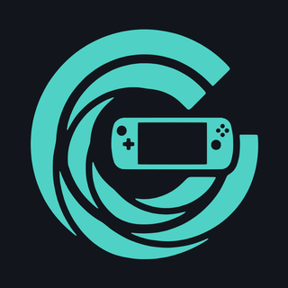
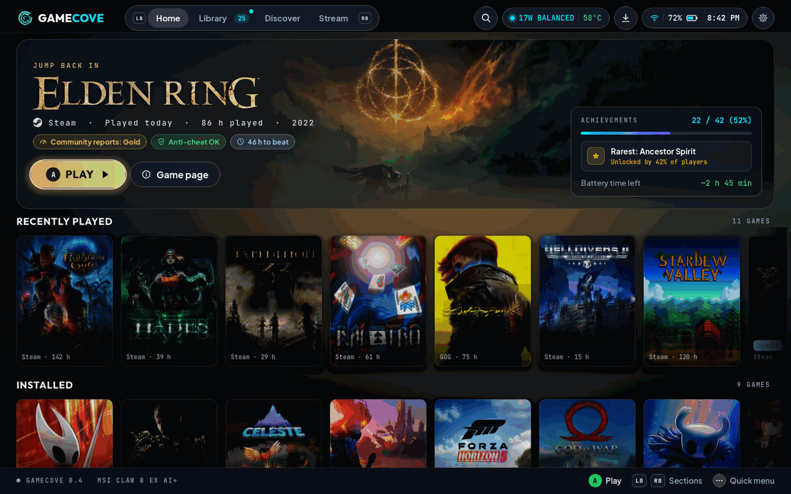
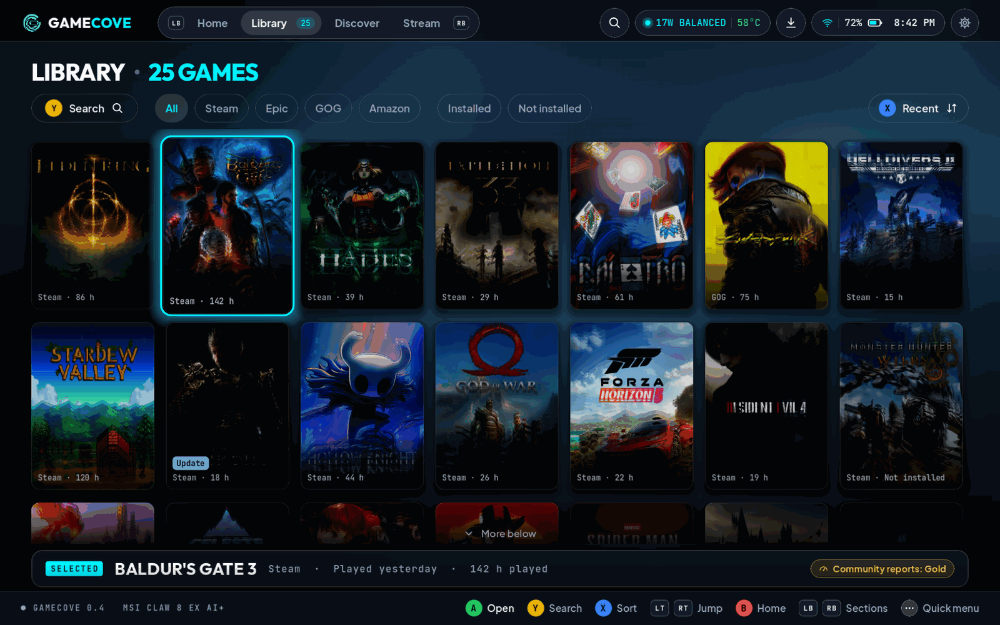
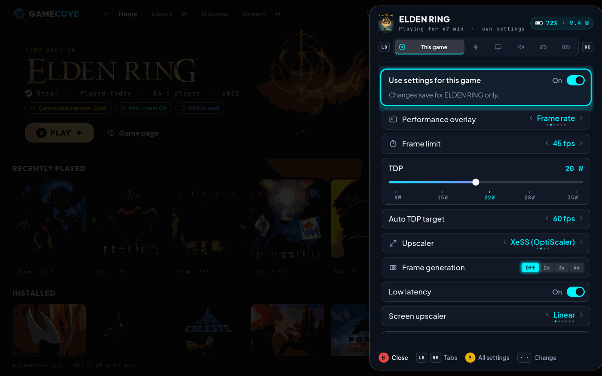
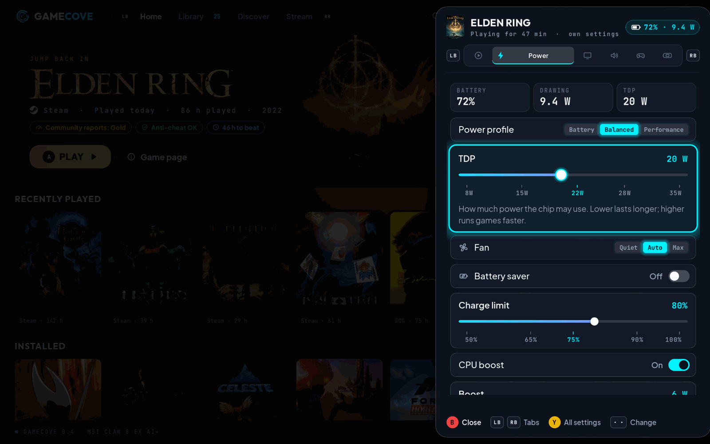
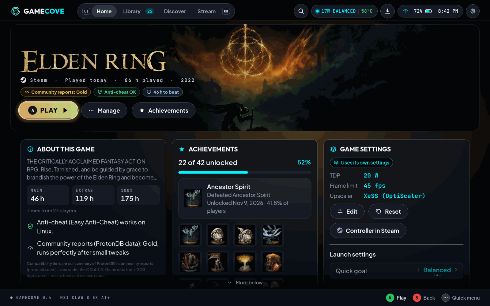
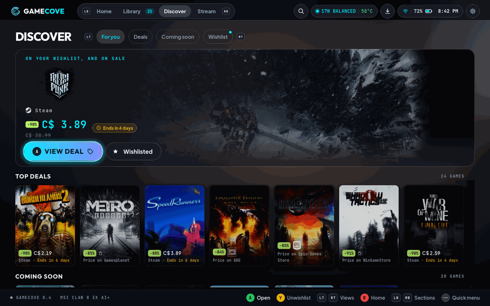
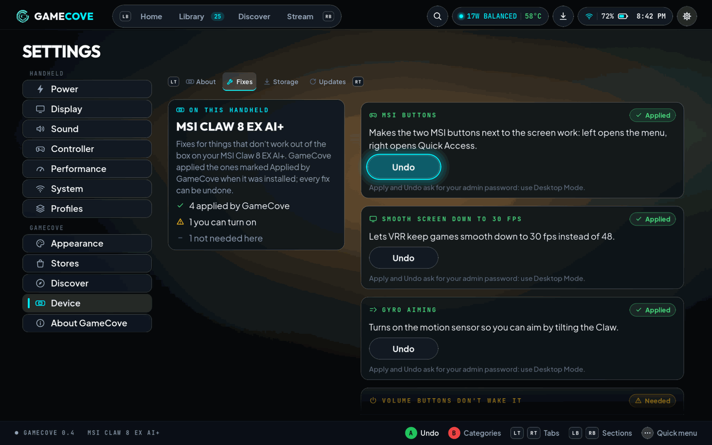
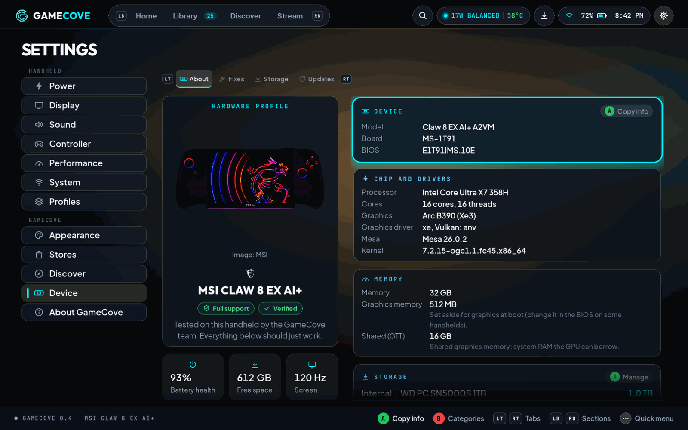
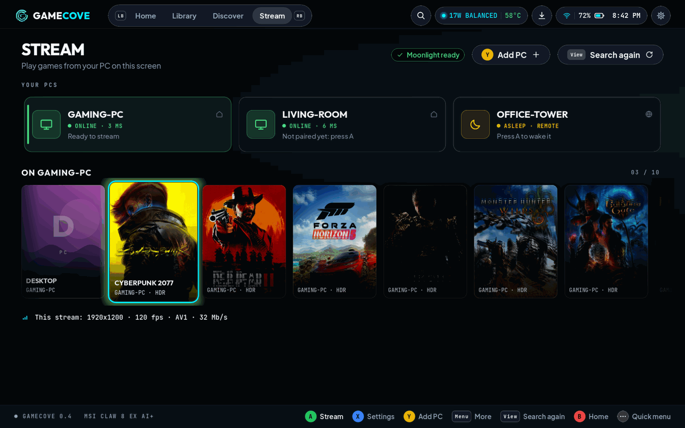

<p align="center"></p>

<h1 align="center">GameCove</h1>

<p align="center"><b>The all-in-one companion for Linux handhelds.</b></p>

<p align="center">
Every store's games in one library, a quick menu with every setting your handheld has, and the fixes your exact model needs.<br>
Free and open source (GPL-3.0). Controller-first. For Bazzite and SteamOS.
</p>

<p align="center">
<a href="#install">Install</a> ·
<a href="#what-gamecove-does">Features</a> ·
<a href="#supported-handhelds">Devices</a> ·
<a href="#faq">FAQ</a> ·
<a href="#network-and-privacy">Privacy</a> ·
<a href="https://discord.gg/tuUsn6sSZH">Discord</a>
</p>

In Desktop Mode, open a terminal and run:

```sh
curl -fsSL https://raw.githubusercontent.com/IHulkSmashI/GameCove/main/packaging/get-gamecove.sh | bash
```

## Screenshots

<table>
<tr>
<td width="50%"><br><sub>Home: what you're playing, what's new, what's on sale</sub></td>
<td width="50%"><br><sub>One library for Steam, Epic, GOG and Amazon</sub></td>
</tr>
<tr>
<td><br><sub>Quick menu in a game: overlay, frame limit, TDP, upscaling</sub></td>
<td><br><sub>Power tab: TDP, boost, fan, battery care</sub></td>
</tr>
<tr>
<td><br><sub>Game page: time to beat, achievements, compatibility</sub></td>
<td><br><sub>Discover: deals, local prices, release calendar</sub></td>
</tr>
<tr>
<td><br><sub>Fixes for your exact model, each with Undo</sub></td>
<td><br><sub>About this device: your model, chip, screen, battery</sub></td>
</tr>
<tr>
<td><br><sub>Stream games from your PC</sub></td>
<td></td>
</tr>
</table>

## What GameCove does

GameCove is the screen your handheld boots into. Your games sit up front, and everything you'd normally need a plugin, a script or a Windows app for is built in: power, screen, controller, lights, fans, battery, upscaling, frame generation, device fixes and updates. It all works with the controller, and every setting has a short line saying what it does.

| | |
| --- | --- |
| **Library** | Steam, Epic, GOG and Amazon games in one place, with art, time to beat, achievements and compatibility |
| **Quick menu** | Every setting your handheld has, one button away, in any game |
| **Profiles** | Settings per game, and different ones on battery and plugged in |
| **Device fixes** | The known problems on your model, fixed for you, each one with Undo |
| **Updates** | OS, BIOS and firmware, drivers and apps in one place |
| **Discover** | Deals, real local prices, your wishlist and a release calendar |
| **Streaming** | Play games running on your PC |

### Home and library

- **Every store in one library.** Steam, Epic, GOG and Amazon side by side. Filter by store, search with the on-screen keyboard, and see what's installed at a glance.
- **Install, update and manage from the handheld.** A download queue with pause and resume, check and repair files, move games to an SD card or USB drive, uninstall, launch options and the Proton version per game. Steam games launch through Steam, so cloud saves and Steam Input keep working. Already use Heroic? GameCove reuses its sign-ins and games.
- **Game pages that tell you what you need.** Cover art and backgrounds, how long it takes to beat (main story, extras, 100%), Steam achievements with your progress, ProtonDB compatibility, and anti-cheat status before you hit play.
- **Store sign-in with your phone.** Scan a QR code and sign in there. No typing passwords on the handheld.
- **Four themes:** Cove, Midnight, Sunset and Light.

### Quick menu

Press the Quick Access button (or Guide) and the quick menu slides in, in a game or on the home screen. It only shows what your handheld can actually do, and anything it can't gets a plain reason instead of a broken switch. Exit game and Switch to Desktop Mode live here too.

| Tab | What you control |
| --- | --- |
| **This game** | Performance overlay, frame limit, TDP, Auto TDP and its target, upscaling, frame generation, the screen upscaler |
| **Power** | Power profile, TDP, boost, fan mode, battery saver, charge limit, CPU boost, energy preference |
| **Display** | Brightness, refresh rate, frame limit, VRR, night light, colour vibrance, screen upscaler and sharpness, screen effects |
| **Audio** | Volume, mute, output device, microphone mute and input |
| **Controller** | Controller type, gyro, Nintendo button layout, rumble, stick lights (effect, colour, brightness), mouse mode |
| **Device** | Wi-Fi, Bluetooth, airplane mode, keep awake, screenshot, plus your device's fixes |

Everything else is one press away in **Settings**, grouped the same way.

<details>
<summary><b>Everything in Settings</b></summary>

- **Power:** TDP and boost limits, power and platform modes, a thermal limit, **Auto TDP** (below), fan presets and **custom fan curves**, **charge limit** and battery care, battery saver that turns on by itself at a level you pick, sleep mode.
- **CPU and graphics:** CPU boost, SMT, active cores, energy preference, governor, CPU ceiling, GPU performance level, GPU clocks, GPU power profile.
- **Display:** refresh rate (and extra refresh rates where the panel allows), VRR, allow tearing, colour temperature, night light with a schedule, vibrance, **HDR** with inverse tone mapping and SDR brightness, screen effects, rotation, dim and screen-off timers.
- **Performance:** the overlay (FPS only, compact, a bar, full, or pick your own items, with position, size and opacity), upscaling, frame generation, low latency, Proton version, shader threads and clearing a game's shader cache.
- **Controller:** controller type (Xbox, DualSense, Steam Deck and more), **back buttons** remapped to any button, a key or a mouse click, gyro on/off and which sensor, stick and trigger deadzones, trackpad mode, **rumble on/off and strength**, a rumble test, **lights** (effect, colours, brightness, speed), mouse mode with pointer speed, a button tester, and one press to start over.
- **Network and system:** Wi-Fi, Bluetooth, airplane mode, Wi-Fi power saving, keep awake, sleep, screenshots.

</details>

**Auto TDP** watches your frame rate and finds the lowest power that keeps it, so the battery lasts longer without you noticing a drop. Give it a target FPS or let it pick one. It learns each game on battery and plugged in, gives power back within seconds in heavy scenes, skips loading screens, and puts everything back when you quit. It's ported from ClawDeck, which was built and tuned on real hardware, and now works on every handheld with a TDP control.

**Upscaling and frame generation** pick the right thing for your chip, per game:

- **Intel Arc:** XeSS on the XMX cores, FSR 4 on XMX, and XeSS frame generation (2x to 4x), through OptiScaler and the XeSS XMX driver.
- **AMD:** FSR 4 on newer chips (using AMD's own files), FSR 3.1 everywhere, FSR frame generation.
- **Any GPU:** Lossless Scaling frame generation through lsfg-vk (2x to 4x, with your own copy of Lossless Scaling).
- **Low latency** (Anti-Lag on AMD, XeLL on Intel Arc) is on by default, and always on while frame generation runs.
- Everything GameCove adds to a game folder is recorded and removed exactly on Undo. Folders set up by other tools are left alone.

### Profiles: per game and per power source

Change something in the quick menu while a game runs and it's saved for that game. Set different values for battery and plugged in, and GameCove switches when you plug in or unplug. When you quit, everything goes back to your everyday settings.

Order of priority: this game on this power source, then this game, then battery or plugged in, then everyday. Profiles stay with the handheld they were made on, and you can copy, reset, export and import them.

### Device fixes

Settings > Device > **Fixes** lists the fixes for your exact model. The ones your handheld needs are applied when you install GameCove; optional ones are a press away. Every fix shows its status, says in one line what it does, and has **Undo**. GameCove also notices when an OS update starts fixing something itself, so you can drop its copy.

| Handhelds | Fixes |
| --- | --- |
| **MSI Claw** | MSI buttons next to the screen work (8 EX) · gyro aiming (8 EX) · smooth VRR down to 30 fps instead of 48 (8 EX, 8 AI+; optional on 7 AI+ and A1M) · volume buttons don't wake it in your bag (every Claw) · Wi-Fi comes back after sleep (optional, Intel Claws) |
| **ASUS ROG Ally** | sticks don't wake it (Ally X, Xbox Ally, Xbox Ally X, X20) · no battery drain while off (Ally, Ally X; optional on the Xbox Allys) · less drain while asleep (optional, every Ally) |
| **GPD** | sleep that works (WIN 4, WIN Max 2) · stays asleep (optional, WIN Max 2) · Intel AX210 Wi-Fi after sleep (WIN 5) |
| **AYANEO** | Intel AX210 Wi-Fi after sleep (2, 2S) |
| **OneXPlayer and AOKZOE** | touch lines up with the picture (OneXFly F1; optional on X1, X1 Mini, 2, 2 Pro, A1, A1 Pro) |
| **Every handheld** | keeps GameCove off the game's CPU cores while you play · fan presets and charge limit where the system has no service for them · AX210 Wi-Fi fix offered wherever that card is fitted |

Steam Deck and Legion Go need nothing extra today: the OS already covers them, and GameCove's settings do the rest.

### Updates

One page for everything that can be updated:

- **System:** SteamOS, Bazzite and Fedora Atomic updates, with progress, then a restart to finish.
- **BIOS and firmware:** checks your maker's latest BIOS for ASUS, Lenovo, MSI and Steam Deck, with step-by-step instructions (for the Ally, GameCove can download the BIOS, check it and put it on a USB drive for EZ Flash). Other makers get a link and your current version to compare. Controllers, docks and other parts update through fwupd.
- **Drivers:** kernel, Mesa, firmware, InputPlumber and friends, the XeSS XMX driver and OptiScaler, compared with the latest versions.
- **Apps:** Flatpak updates.

GameCove never flashes a BIOS by itself, and firmware installs wait until you're on the charger with at least 50% battery and no game running.

### Streaming from your PC

The **Stream** tab plays games running on your PC. Install [Vibepollo](https://github.com/Nonary/Vibepollo) on the PC (Sunshine and Apollo work too) and GameCove finds it on your network, pairs with a PIN, shows your PC's games with box art, wakes the PC, and streams at your handheld's exact resolution and refresh rate through Moonlight (installed for you). Resolution, frame rate, quality, video format and HDR can be set per PC or per game, and it works away from home over Tailscale.

### Discover

- **Deals** from the big stores, sorted and filtered by store, with the lowest price ever next to today's.
- **Real local prices** for your Steam region, never converted guesses.
- **Your wishlist**, imported from Steam, with price alerts.
- **Release calendar** by month or as a list, with a reminder on release day.

### Safety and reliability

- **Desktop Mode is always one press away**, from the quick menu, and Steam Gaming Mode too.
- **Crash fallback:** if GameCove crashes three times in two minutes, your handheld goes back to Steam Gaming Mode by itself.
- **Nothing above your device's limits.** Power, boost, clocks, fan curves and charge limits are clamped to what your model is rated for, and checked again by the system helper.
- **Risky screen changes revert by themselves.** After HDR or a new refresh rate you get "Keep this?" with a 15-second countdown.
- **Undo everything:** fixes, upscaling files, launch options, profiles. Uninstalling puts Steam Gaming Mode back as the default.
- **Signed releases.** The installer checks every download against a signed checksum list before anything runs.
- **Day-to-day settings never ask for a password.** Only the install and system fixes do, in Desktop Mode.

## Network and privacy

No analytics, no crash reports, no telemetry, no GameCove account. GameCove never sends serial numbers, store account IDs or anything you type into its settings to us. It only talks to the services it needs to do its job:

| What | Who | What is sent | When | Switch |
| --- | --- | --- | --- | --- |
| Game database and release calendar | GitHub (GameCove's own `gamedb` release) | Nothing about you | At start, at most daily | Background lookups |
| Deals and prices | [CheapShark](https://www.cheapshark.com) (cheapshark.com) and the Steam store API | Steam app ids and titles from your wishlist and Discover, what you search for, your store country | 45 s after start, then every 6 hours; when you search or open a game | Look up deals and prices |
| Local prices (optional) | [GG.deals](https://gg.deals) (gg.deals) | Steam app ids, your region, your own API key | With the deals refresh, only if you added a key | Look up deals and prices, or remove the key |
| Your device's photo | GitHub (free photos) or your handheld's maker | One request; the address tells the site your model | At start until it's saved, then weekly | Show maker photos, Background lookups |
| BIOS and firmware list | GitHub (`firmware` release, signed), then only the maker's own site | Nothing about you | When you check for updates or prepare a USB drive | You start it |
| Achievements and game art | Steam's API and CDN; SteamGridDB only with your own key | The game's app id (and your SteamGridDB key) | When you open a game page or a tile needs art | Settings > Performance; remove the key |
| Game streaming | PCs on your own network (GameStream: Vibepollo, Sunshine, Apollo) | A fixed client id and Moonlight's certificate; Wake-on-LAN packets | When you open the Stream tab or wake a PC | You start it |
| Updates, store sign-ins | Your OS, Flatpak, fwupd/LVFS, legendary / gogdl / nile | Those tools' own requests | When you update or sign in | You start it |

**Settings > About > Network and privacy** has the switches: **Background lookups** (off: nothing is requested unless you ask for it right then), **Look up deals and prices** and **Show maker photos**, all on by default. Some store links can carry a GameCove affiliate id (Settings > Discover > **Affiliate links**; none are set up yet). It only changes the link, never the price, and sends nothing about you. Every call is listed in [docs/PRIVACY.md](docs/PRIVACY.md).

## Supported handhelds

GameCove recognises your exact model and sets itself up for it. Here's every model, and About this device in the app shows the same photo of yours.

<p align="center"></p>

<sub>Photos: the makers' official product images (their property, removed on request), except Steam Deck (LCD) by Liam Dawe/GamingOnLinux, <a href="https://commons.wikimedia.org/wiki/File:Steam_Deck_(front).png">CC BY-SA 4.0</a>.</sub>

| Maker | Tested on hardware | Supported | Basic |
| --- | --- | --- | --- |
| **MSI** | Claw 8 EX AI+ (Bazzite) | Claw 8 AI+, Claw 7 AI+, Claw A1M, Claw A8 | |
| **ASUS** | ROG Ally (SteamOS) | ROG Ally X, ROG Xbox Ally, ROG Xbox Ally X, ROG Xbox Ally X20 | |
| **Valve** | | Steam Deck LCD, Steam Deck OLED | |
| **Lenovo** | | Legion Go, Legion Go 2 (and Z2), Legion Go S (Z2 Go and Z1 Extreme) | |
| **OneXPlayer** | | OneXFly F1, F1 Pro and Apex; X1 (AMD, Intel, Mini, Pro); 2 and 2 Pro; G1 (AMD, Intel); 3 | X2 Mini, X2 Mini Pro, Super X |
| **AOKZOE** | | A1, A1 Pro, A1X | |
| **AYANEO** | | 2, 2S, 3, KUN, AIR 1S, AIR Plus, Flip, Flip 1S DS, Slide | |
| **GPD** | | WIN 4, WIN Mini, WIN Max 2, WIN 5 | |
| **ZOTAC** | | Gaming Zone | |
| **Acer** | | Predator Atlas 8 | Nitro Blaze 7, 8 and 11 |
| **Orange Pi** | | Neo | |

- **Tested on hardware:** we've run GameCove on it. Every setting was changed, read back from the hardware and put back.
- **Supported:** set up from data that InputPlumber, steamos-manager, PowerStation and Handheld Daemon tested on that device. Power limits, fans, lights, buttons and fixes are all there.
- **Basic:** GameCove runs with safe settings for the chip, and model-specific settings stay hidden until someone with the device helps us test it. Any other handheld gets this too.

Got one of the Supported or Basic models? Run it and tell us how it went; that's how a model moves up. Details per device: [docs/DEVICES.md](docs/DEVICES.md).

## Install

1. Switch to Desktop Mode and open a terminal (Konsole).
2. Run the command at the top of this page. It downloads the latest release, checks its signature, adds **GameCove Installer** to your app menu and opens it.
3. The installer walks you through it: **Easy** (recommended settings, one summary page) or **Custom** (every option). Choose whether your handheld boots into GameCove or keeps Steam Gaming Mode as the default with GameCove one tap away, sign in to your stores, pick your fixes and extras (like Moonlight for streaming), and you're done.

It asks for your admin password once, for the system package and device fixes.

- **Bazzite and Fedora Atomic:** installs as a system package. Your previous system stays in the boot menu.
- **SteamOS:** installs as a system extension that survives SteamOS updates. Read-only mode stays on. After a SteamOS update, restart once so GameCove comes back.

### Update, change or remove

Open **GameCove Installer** from the app menu any time to **update**, **change options**, **repair** or **remove** GameCove. Removing it makes Steam Gaming Mode the default again, can undo every fix, and can keep or delete your settings. Store sign-ins stay with the store tools. Everything the installer does is logged to `~/.local/share/gamecove/installer.log`.

## FAQ

**Does it replace Steam?**
No. Steam keeps running in the background, Steam games launch through Steam, and Steam Gaming Mode is always one press away.

**Do you need Decky Loader or any plugins?**
No. Power, Auto TDP, fans, lights, the overlay, upscaling and frame generation are all built in. If you already use Decky plugins, GameCove leaves their files alone.

**Can it break your system?**
Everything GameCove changes can be undone, on Bazzite your previous system stays in the boot menu, and if GameCove ever fails to start you land in Steam Gaming Mode.

**Does anti-cheat work?**
Games run on the same Proton as they do in Steam. GameCove shows each game's anti-cheat status, and it never bypasses or tampers with anti-cheat.

**Does it cost anything?**
No. GameCove is free and open source, and device fixes, battery features and safety settings will never sit behind a paywall.

**What about CachyOS or other distros?**
Bazzite and SteamOS come first. On other systems GameCove runs in a window, and a CachyOS package is planned.

**Your handheld isn't listed?**
It still runs with Basic support. Open an issue with your device report and we'll add it.

## Community

- **Discord:** chat, testing and help, [discord.gg/tuUsn6sSZH](https://discord.gg/tuUsn6sSZH)
- **Reddit:** news and tips, [r/GameCoveLinux](https://www.reddit.com/r/GameCoveLinux/)
- **GitHub:** [bugs and ideas](https://github.com/IHulkSmashI/GameCove/issues/new/choose), [discussions](https://github.com/IHulkSmashI/GameCove/discussions), and [sign up to test on your handheld](https://github.com/IHulkSmashI/GameCove/issues/new?template=tester_signup.yml)

More in [docs/COMMUNITY.md](docs/COMMUNITY.md).

## Credits

GameCove has its own front end and device layer, built on proven open-source work: gamescope, Proton and umu-launcher, InputPlumber, PowerStation, steamos-manager and Handheld Daemon, legendary, gogdl and nile for the stores, MangoHud, OptiScaler, lsfg-vk and Moonlight. Auto TDP, the upscaling setup and the MSI Claw findings are ported from **ClawDeck** (same author). Gyro on the MSI Claw 8 EX was figured out by **Kisenir** (r/MSIClaw). Our game database is rebuilt nightly from free, open sources: Wikidata, AreWeAntiCheatYet, ProtonDB and IGDB. Game data from [IGDB](https://www.igdb.com): time to beat and upcoming release dates. Compatibility tiers are our own summary of [ProtonDB](https://www.protondb.com) community reports, shared under the ODbL 1.0. The full list is in [CREDITS.md](CREDITS.md).

## Licence

GPL-3.0-or-later. See [LICENSE](LICENSE).

A few parts carry their own licences: the Claw 8 EX gyro fix's HID-BPF program is GPL-2.0-only and its helper scripts GPL-2.0-or-later; the VRR fix's panel list derives from MIT-licensed code; the app is built on Godot Engine (MIT); the fonts are OFL-1.1. Every release carries these texts, and the app shows them under Settings > About > Credits and licenses. Details in [CREDITS.md](CREDITS.md) and [LICENSES/](LICENSES/).

**The brand logos in `app/assets/brand/` are not GPL-licensed.** They're the makers' and stores' trademarks, shown only to identify a device, chip, store or launcher, and removed on request ([docs/BRANDS.md](docs/BRANDS.md), [app/assets/brand/LICENSE.md](app/assets/brand/LICENSE.md)). Device photos are the makers' property: most are fetched from the maker's own site when the app needs them, one (the Acer Nitro Blaze 8) is bundled, and the README's device grid shows them all. Any of them is removed on request. GameCove isn't affiliated with or endorsed by any of these companies.
