<p align="center">
  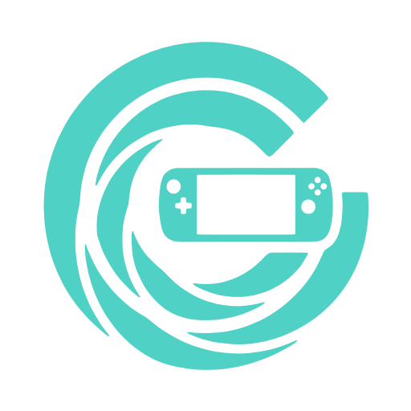
</p>

<h1 align="center">GameCove</h1>

<p align="center"><b>The all-in-one companion for Linux handhelds.<br>Every store's games in one library, a quick menu with every setting your handheld has,<br>and the fixes your exact model needs. Free, open source and controller-first.</b></p>

<p align="center">
  <a href="https://github.com/IHulkSmashI/GameCove/releases"></a>
  <!-- Downloads badge goes back once v0.1.0 is out, filtered to the GameCove release (the total counts the app's own data downloads): https://img.shields.io/github/downloads/IHulkSmashI/GameCove/v0.1.0/total -->
  <a href="https://github.com/IHulkSmashI/GameCove/commits/main"></a>
  <br>
  <a href="#contents"></a>
  <a href="https://discord.gg/tuUsn6sSZH"></a>
  <a href="https://www.reddit.com/r/GameCoveLinux/"></a>
  <a href="https://github.com/IHulkSmashI/GameCove/discussions"></a>
  <a href="https://github.com/IHulkSmashI/GameCove/issues/new?template=tester_signup.yml"></a>
  <br>
  <a href="#install"></a>
  <a href="https://godotengine.org"></a>
  <a href="https://ko-fi.com/gamervault"></a>
  <a href="LICENSE"></a>
</p>

<p align="center">
  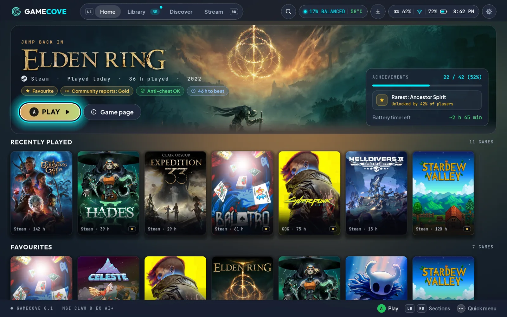
  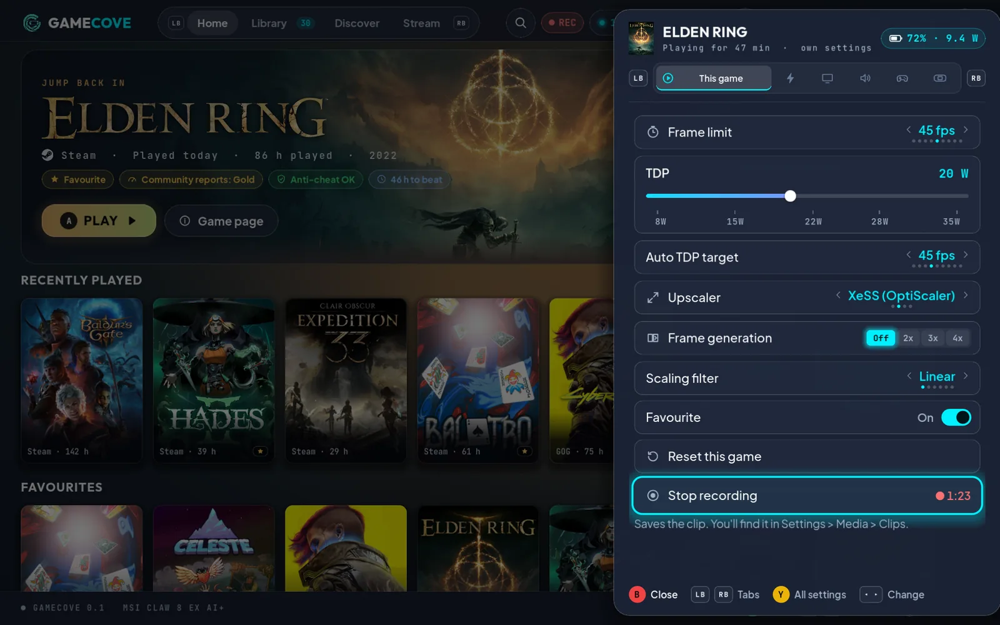
  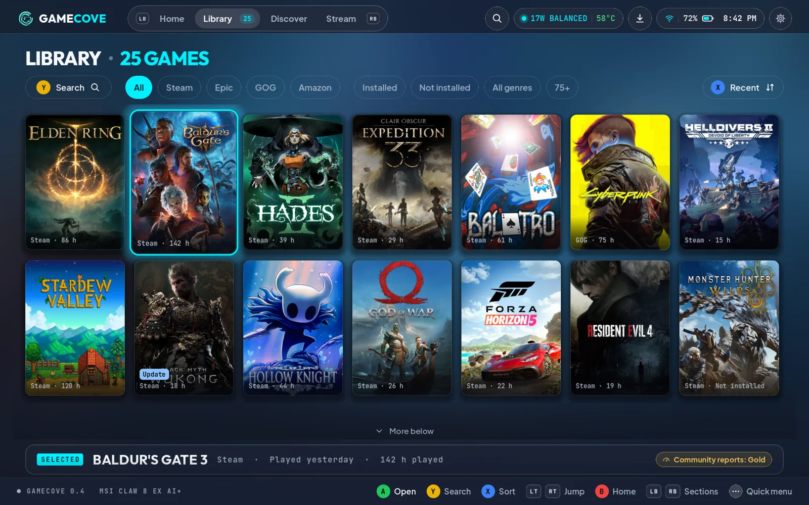
</p>

## One app, the whole handheld

GameCove is the screen your handheld boots into. Your games sit up front, and everything you'd normally need a plugin,
a script or a Windows app for is built in.

- 🎮 **Every store, one library.** Steam, Epic, GOG and Amazon side by side, with art, critic scores, time to beat,
  achievements and ProtonDB ratings. Install, update, repair and move games right from the handheld.
- ⚡ **A quick menu with every setting your handheld has**, one button away in any game: TDP, fan, frame limit,
  refresh rate, VRR, gyro, stick lights, charge limit and more. It only shows what your model can actually do.
- 🔋 **Auto TDP** finds the lowest power that holds your frame rate, learns each game on battery and plugged in, and
  gives power back within seconds when a scene gets heavy.
- 🔥 **Upscaling and frame generation picked for your chip:** XeSS and FSR 4 on Intel's XMX cores, FSR 4 and 3.1 on
  AMD, Lossless Scaling frame generation on anything, with low latency on by default.
- 🛠️ **Fixes for your exact model,** applied at install, each with one line on what it does and an **Undo**.
- 🕹️ **Emulation with EmuDeck:** your ROMs show up as games with their art and console, and ES-DE, EmuDeck and
  Steam ROM Manager open from one Emulation page. Favourites, hidden games and collections work for every store.
- 🎯 **Profiles per game and per power source.** Change it in a game and it's saved for that game, with different
  values on battery and plugged in.
- 🏷️ **Discover:** deals in your real local prices, wishlist price alerts and a release calendar.
- 📺 **Stream from your PC** through Moonlight: GameCove finds your PC, pairs with a PIN and wakes it.
- 🔄 **One Updates page** for the OS, BIOS and firmware, drivers, upscalers and apps.
- 🛡️ **Safe by design:** everything can be undone, repeated crashes drop you back in Steam Gaming Mode, and there's no
  telemetry and no account.

**Tested on** the MSI Claw 8 EX AI+ (Bazzite) and the ASUS ROG Ally (SteamOS), and 46 more models set up from
tested data. GameCove recognises your exact model and only shows what it can do:

| Support | Handhelds |
| --- | --- |
| **Tested on hardware** | MSI Claw 8 EX AI+, ASUS ROG Ally |
| **Supported** | Steam Deck LCD and OLED, the other MSI Claws, ROG Ally X and Xbox Allys, Legion Go, Go 2 and Go S, most OneXPlayers, AOKZOE, AYANEO, GPD, ZOTAC, Acer Predator Atlas 8, Orange Pi Neo ([every model](#supported-handhelds)) |
| **Basic** | Any other handheld: safe settings for the chip, and model settings once someone helps us test it |

| System | How GameCove installs |
| --- | --- |
| **Bazzite** and Fedora Atomic | A system package; your previous system stays in the boot menu |
| **SteamOS** | A system extension that survives SteamOS updates; read-only mode stays on |

> **Install in one line.** In Desktop Mode, open a terminal (Konsole) and run:
>
> ```sh
> curl -fsSL https://raw.githubusercontent.com/IHulkSmashI/GameCove/main/packaging/get-gamecove.sh | bash
> ```
>
> The installer takes it from there. Full steps: [Install](#install).

---

## Contents

1. [Home and library](#home-and-library)
2. [Emulation](#emulation)
3. [Quick menu and settings](#quick-menu-and-settings)
4. [Auto TDP, upscaling and frame generation](#auto-tdp-upscaling-and-frame-generation)
5. [Profiles](#profiles)
6. [Device fixes](#device-fixes)
7. [Updates](#updates)
8. [Streaming from your PC](#streaming-from-your-pc)
9. [Discover](#discover)
10. [Safety and reliability](#safety-and-reliability)
11. [Performance](#performance)
12. [Network and privacy](#network-and-privacy)
13. [Supported handhelds](#supported-handhelds)
14. [Install](#install)
15. [FAQ](#faq)
16. [Community](#community)
17. [Credits](#credits)
18. [Licence](#licence)

---

## Home and library

- **Every store in one library.** Steam, Epic, GOG and Amazon side by side. Filter by store, genre, critic score (75+)
  or what's installed, sort by Top rated, and search with the on-screen keyboard.
- **Home stays quick with a big library.** Each Home shelf shows its first 24 games and ends with **See all**, which
  opens the Library on the same list. Thousands of ROMs don't slow Home down.
- **Favourites, hidden games and collections.** Press Menu on any game (or the star on its page) to make it a
  favourite, put it in a collection or hide it. Favourites get their own shelf on Home; the Library's Filter button (or View) opens its Filter
  sheet for favourites, a collection, emulated games or hidden games. Your Steam collections, favourites and hidden
  games show up too (read-only: GameCove never changes them).
- **Install, update and manage from the handheld.** A download queue with pause and resume, check and repair files,
  move games to an SD card or USB drive, uninstall, launch options and the Proton version per game. Steam games launch
  through Steam, so cloud saves and Steam Input keep working. Already use Heroic? GameCove reuses its sign-ins and games.
- **Game pages that tell you what you need.** Cover art and backgrounds, the Metacritic score (and OpenCritic's with
  your own key), genres, developer, publisher, release date, screenshots, how long it takes to beat (main story,
  extras, 100%), Steam achievements with your progress, ProtonDB compatibility, and anti-cheat status before you hit
  play.
- **Complete details for every store.** Missing descriptions, genres, release dates, screenshots and art get filled in
  for Epic, GOG and Amazon games too, from the game's Steam edition and GameCove's nightly game database.
- **Steam insights.** On a Steam game's page: players right now, review score, the Steam Deck rating, the last update
  with its patch notes, DLC with prices, and a SteamDB link you open on your phone.
- **Change artwork.** Pick any cover, banner, logo or icon from SteamGridDB's community for any game, Steam or not (it
  can update Steam's own library art too). Free with your own SteamGridDB key, which setup gets you in about a minute.
- **Cloud saves for Epic and GOG.** Just before an Epic or GOG game starts, GameCove gets your newest save from the
  store's own cloud (through legendary and Heroic's gogdl, with your sign-in); just after it ends, yours goes up. The
  game page says how it stands ("Saves synced 2 min ago"), with a switch per game, Sync now, and a local backup before
  anything replaces a save on the handheld. Changed on both sides? You pick, with the newer one highlighted. No
  connection? The game starts anyway. Steam games keep Steam Cloud; Amazon games aren't covered (nile has no save sync).
- **Battery drain per game.** "Drains about 9 W, ~5 h on a full charge" on a game's page once you've played it on
  battery for a while, and a 7-day battery chart with every game's drain in About this device. Recorded only when a
  game starts or ends, the handheld sleeps or wakes, or the charger goes in or out.
- **Store sign-in with your phone.** Scan a QR code and sign in there. No typing passwords on the handheld.
- **Your desktop apps too.** Browsers, Discord, Spotify, a video player, emulator front-ends: every Flatpak and desktop
  app on the handheld (minus settings tools and terminal programs) in an **Apps** view, reached from the Library's
  header or Home. Pin your favourites to Home's Apps shelf with X; they open full screen like a game, with the quick
  menu over them, and closing one brings you back.
- **Controller battery in the top bar** for wired, 2.4 GHz and Bluetooth pads that report one (from UPower, read when
  something changes, never on a timer).
- **Four themes:** Cove, Midnight, Sunset and Light.

<table>
<tr>
<td width="33%">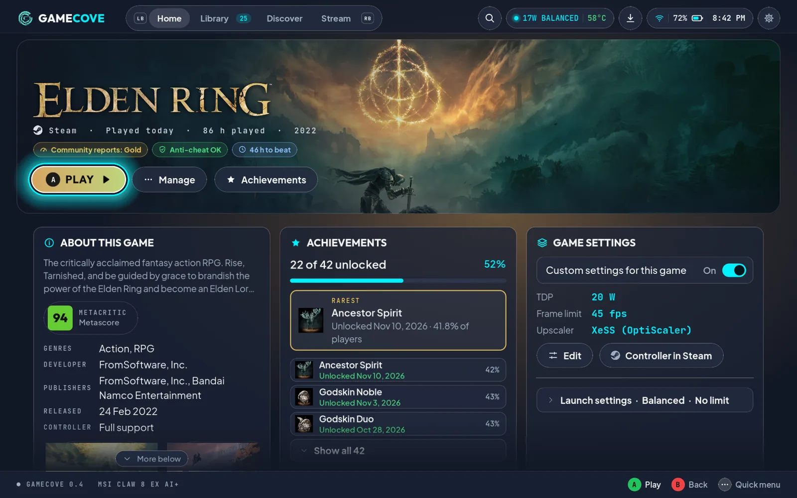<br><sub>Game page: Metacritic, game facts, time to beat</sub></td>
<td width="33%">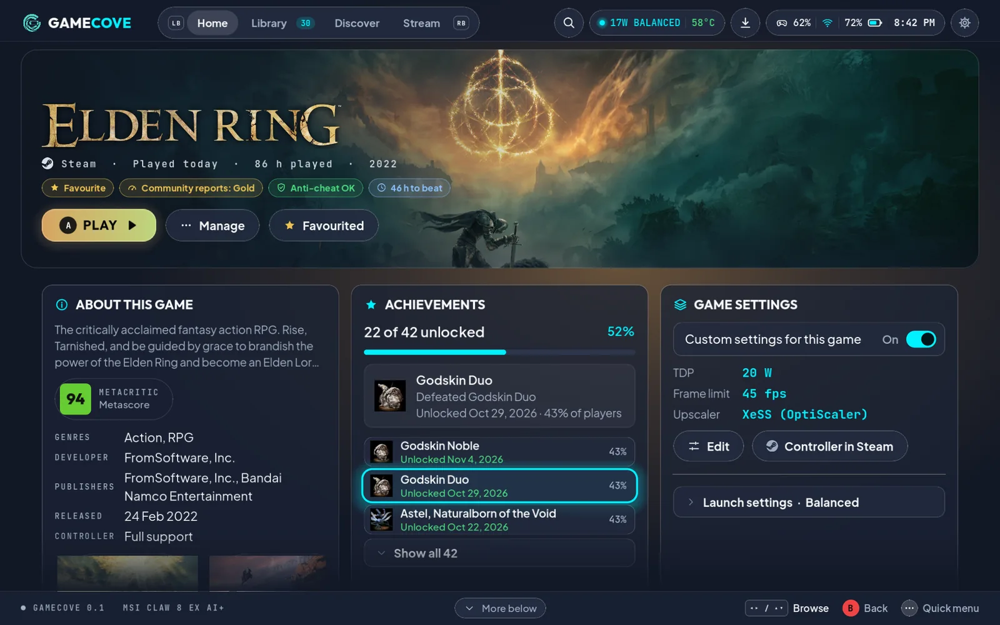<br><sub>Achievements with global unlock rates</sub></td>
<td width="33%">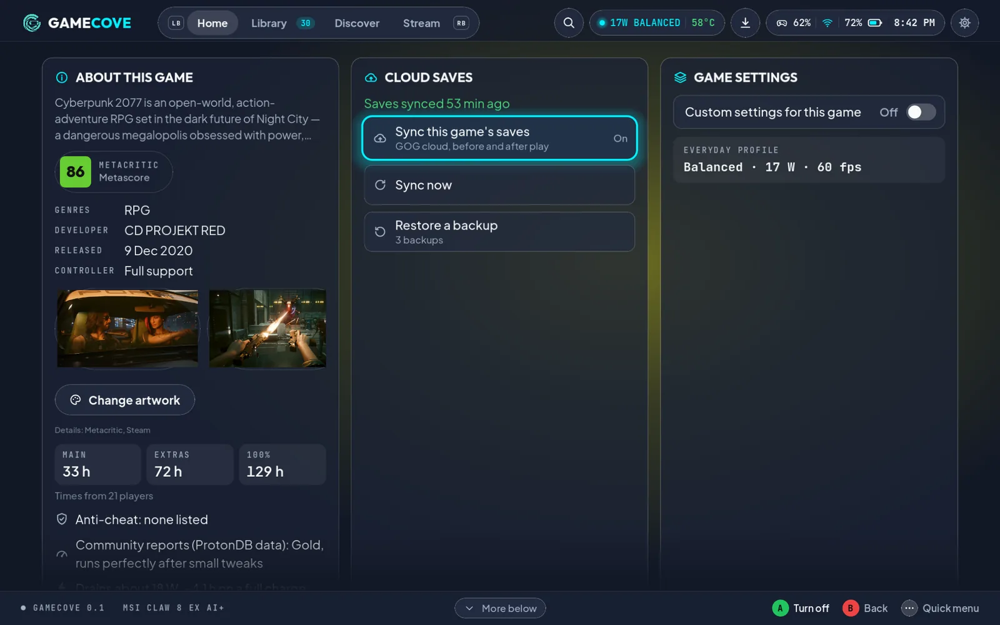<br><sub>Cloud saves for a GOG game, and what it drains on battery</sub></td>
</tr>
<tr>
<td>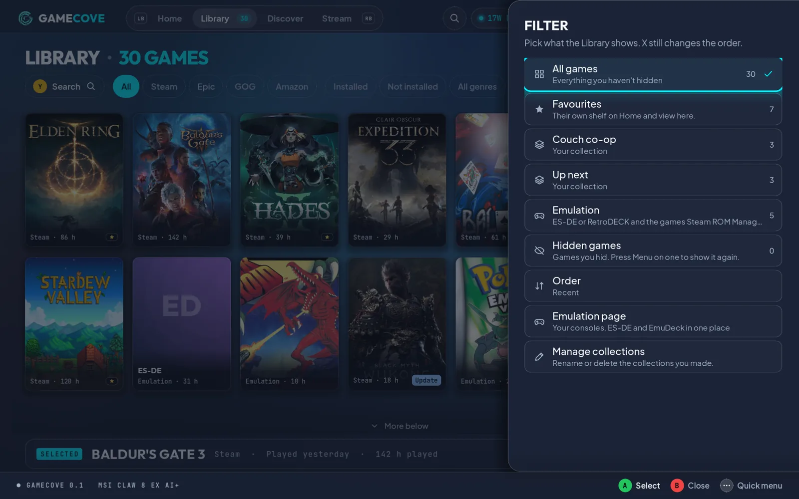<br><sub>Filter: favourites, your collections, emulation, hidden games</sub></td>
<td>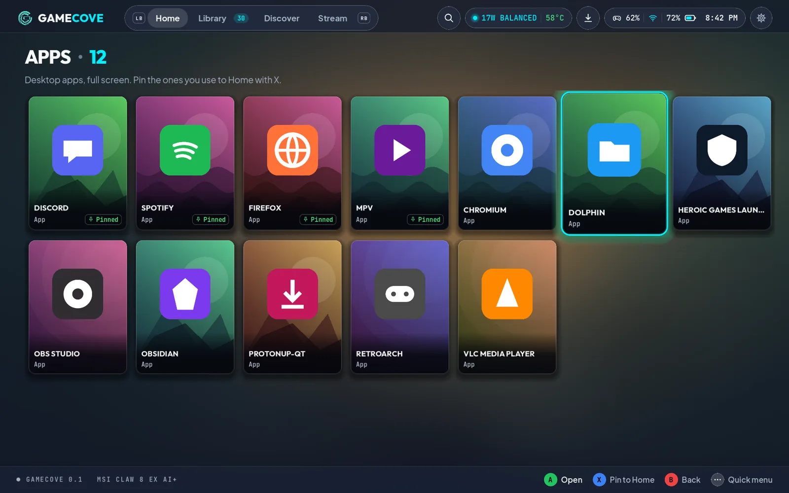<br><sub>Your desktop apps, full screen, pinned to Home with X</sub></td>
<td>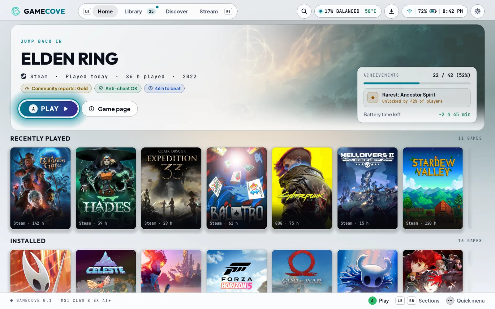<br><sub>The Light theme</sub></td>
</tr>
</table>

## Emulation

GameCove works with what EmuDeck (or RetroDECK, or ES-DE on its own) already set up, so your console games live in the
same interface as everything else.

- **Your ROMs in the library.** Steam ROM Manager's games show up as games, with the art it picked, a badge for the
  console, and play time. They start through Steam, exactly as Steam starts them.
- **One Emulation page** (Library > Filter > Emulation page, or ES-DE's tile): open ES-DE or RetroDECK full screen
  like a game (the quick menu works over it), open EmuDeck for emulator updates and settings, and **Add or update ROMs
  in the library** with Steam ROM Manager. It shows your systems with how many games each has, and what you played
  last in ES-DE.
- **Nothing installed yet?** The page shows a QR code to emudeck.com and three short steps.
- GameCove never downloads or ships games or BIOS files. Play backups of games you own.

<table>
<tr>
<td width="50%">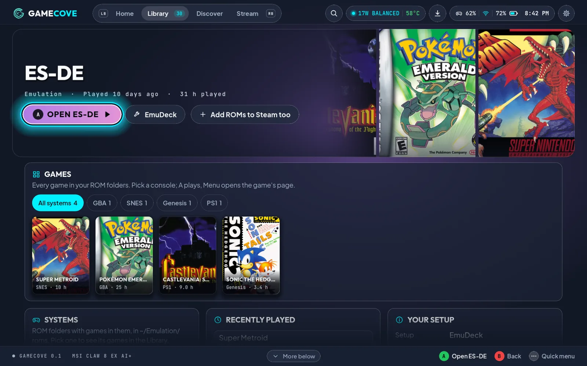<br><sub>The Emulation page: ES-DE, EmuDeck, Steam ROM Manager, your systems</sub></td>
<td width="50%">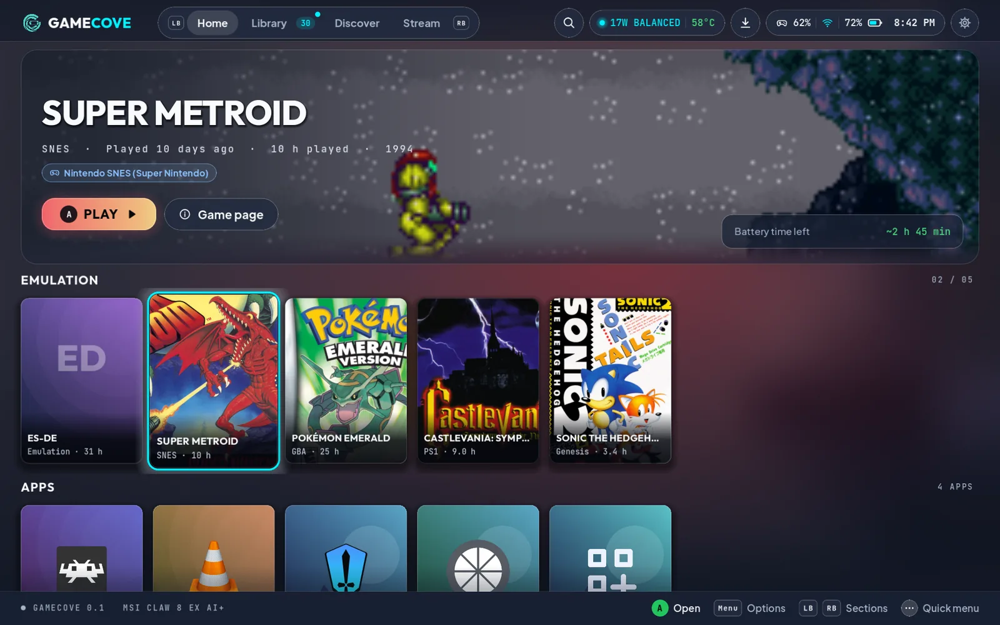<br><sub>Your ROMs on Home with their box art, and the Apps shelf</sub></td>
</tr>
</table>

## Quick menu and settings

Press the Quick Access button (or Guide) and the quick menu slides in, in a game or on the home screen. It only shows
what your handheld can actually do, and anything it can't gets a plain reason instead of a broken switch. Exit game and
Switch to Desktop Mode live here too.

| Tab | What you control |
| --- | --- |
| **This game** | Performance overlay, frame limit, TDP, Auto TDP and its target, upscaling, frame generation, Lossless frame gen, the scaling filter, and **Record** (screen and sound, until you stop it) |
| **Power** | Power profile, TDP, boost, fan mode, battery saver, charge limit, CPU boost, energy preference (Settings > Power also has **Sleep at low battery**: at 3 to 10 % on battery, a 30 s warning any button cancels, then sleep; off by default) |
| **Display** | Brightness, refresh rate, frame limit, VRR, night light, colour vibrance, scaling filter and sharpness, screen effects |
| **Audio** | Volume, mute, output device, microphone mute and input, each app's own volume, and play/pause and skip for the music playing behind your game |
| **Controller** | Controller type, gyro, Nintendo button layout, rumble, stick lights (effect, colour, brightness), mouse mode |
| **Device** | Wi-Fi, Bluetooth and your Bluetooth devices, airplane mode, keep awake, screenshot, plus your device's fixes |

<table>
<tr>
<td width="50%">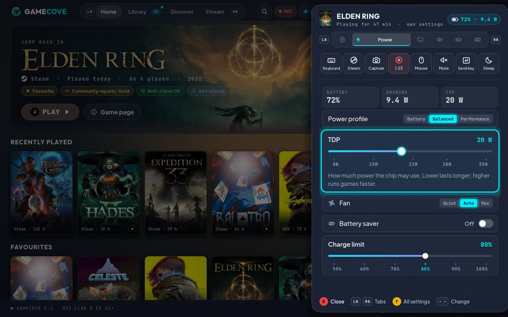<br><sub>Power: TDP, fan, battery saver, charge limit</sub></td>
<td width="50%">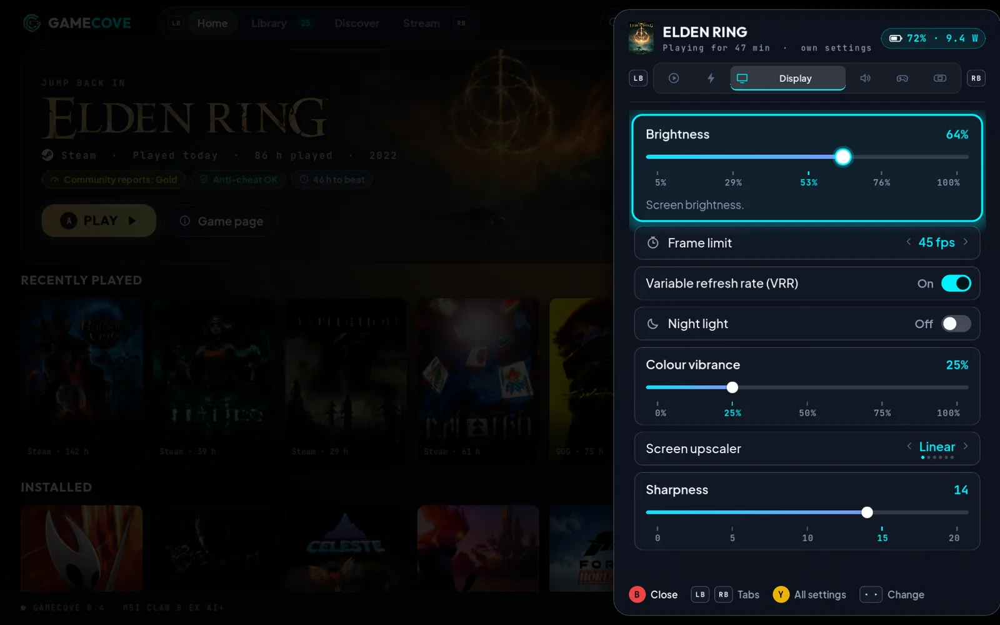<br><sub>Display: brightness, refresh rate, VRR, vibrance</sub></td>
</tr>
<tr>
<td>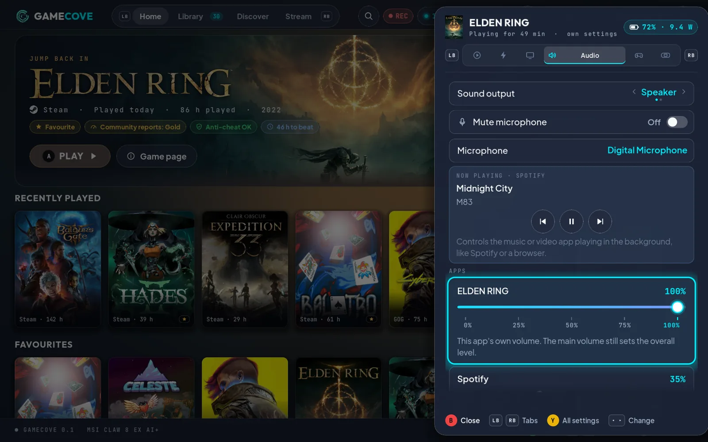<br><sub>Audio: the music playing, each app's own volume</sub></td>
<td>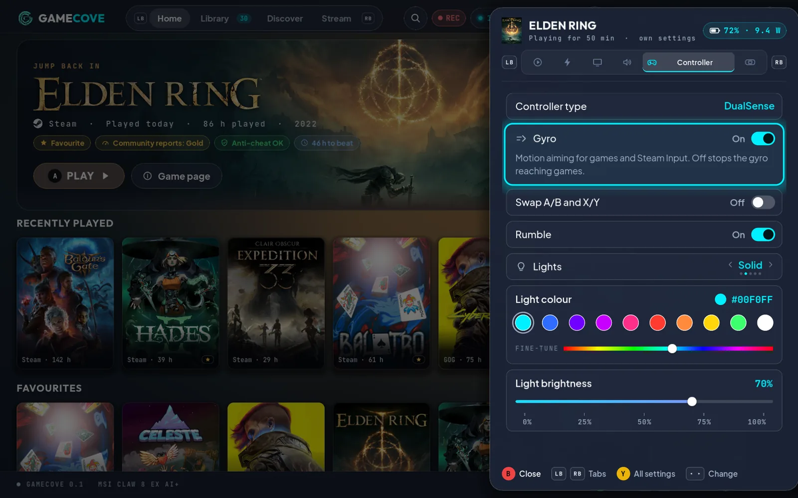<br><sub>Controller: type, gyro, rumble</sub></td>
</tr>
<tr>
<td>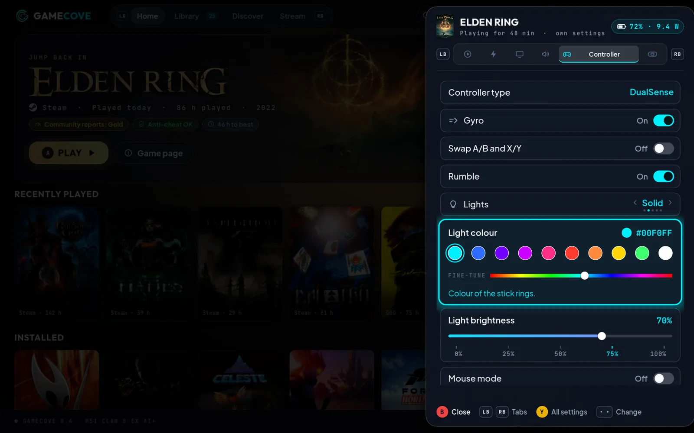<br><sub>Stick lights: effect, colour, brightness</sub></td>
<td>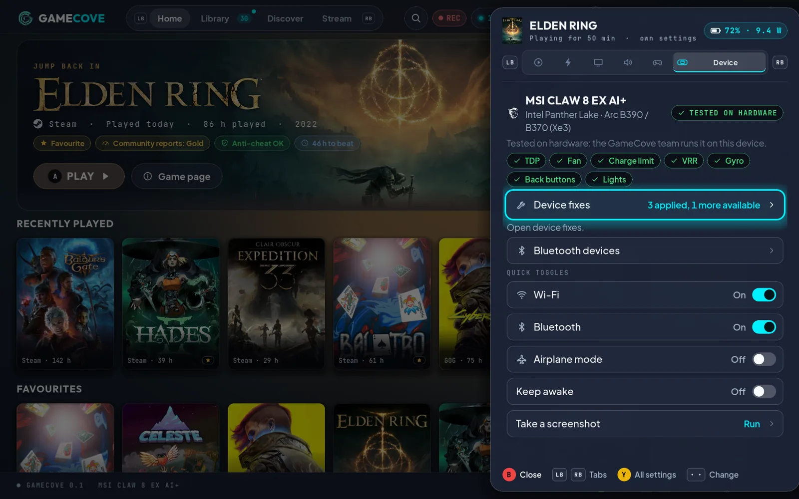<br><sub>Device: your model, its fixes, Wi-Fi and Bluetooth</sub></td>
</tr>
</table>

Everything else is one press away in **Settings**, grouped the same way, and every setting has a short line saying what
it does.

<details>
<summary><b>Everything in Settings</b></summary>

- **Power:** TDP and boost limits, power and platform modes, a thermal limit, **Auto TDP**, fan presets and **custom
  fan curves**, **charge limit** and battery care, battery saver that turns on by itself at a level you pick, sleep
  mode, plus CPU (boost, SMT, active cores, energy preference, governor, CPU ceiling) and graphics (GPU performance
  level, clocks, power profile).
- **Display:** refresh rate (and extra refresh rates where the panel allows), VRR, allow tearing, colour temperature,
  night light with a schedule, vibrance, **HDR** with inverse tone mapping and SDR brightness, screen effects, rotation,
  dim and screen-off timers.
- **Sound:** volume, output device, microphone and input, plus a volume for each app playing sound (turn the game
  down under your music or a voice chat).
- **Controller:** controller type (Xbox, DualSense, Steam Deck and more), **back buttons** remapped to any button, a key
  or a mouse click, gyro on/off and which sensor, stick and trigger deadzones, trackpad mode, **rumble on/off and
  strength**, a rumble test, **lights** (effect, colours, brightness, speed), mouse mode with pointer speed, a button
  tester, and one press to start over.
- **Performance:** the overlay (FPS only, compact, a bar, full, or pick your own items, with position, size and
  opacity), upscaling and frame generation with installed versions and updates, Lossless Scaling frame generation,
  Proton version, low latency, shader threads and clearing a game's shader cache, plus **GE-Proton**: install the
  newest release in one press (checked against its checksum) and remove old ones.
- **System:** Wi-Fi, Bluetooth, airplane mode, Wi-Fi power saving, keep awake, sleep, screenshots, and **Bluetooth
  devices**: connect your controller or headphones, see their battery, pair new ones and forget old ones.
- **Media:** recording with GPU Screen Recorder (install it from here, the one-time screen-capture OK, sound on or
  off, 30 or 60 fps) and **Clips**: everything you recorded, with a picture, its length and size. Watch one full
  screen (in mpv, VLC or Celluloid; no player yet? one press installs mpv), **send it to your phone** with a QR code
  (a one-time page on your own Wi-Fi to watch and download it), or delete it.
- **Profiles, Appearance, Stores, Discover, Device and About GameCove:** your saved profiles, themes, store sign-ins and
  downloads, Discover's region and keys (SteamGridDB, gg.deals, OpenCritic), fixes, storage (with one-press
  **clean-up** of the shader caches uninstalled games leave behind), updates, and the network and privacy switches.

<table>
<tr>
<td width="50%">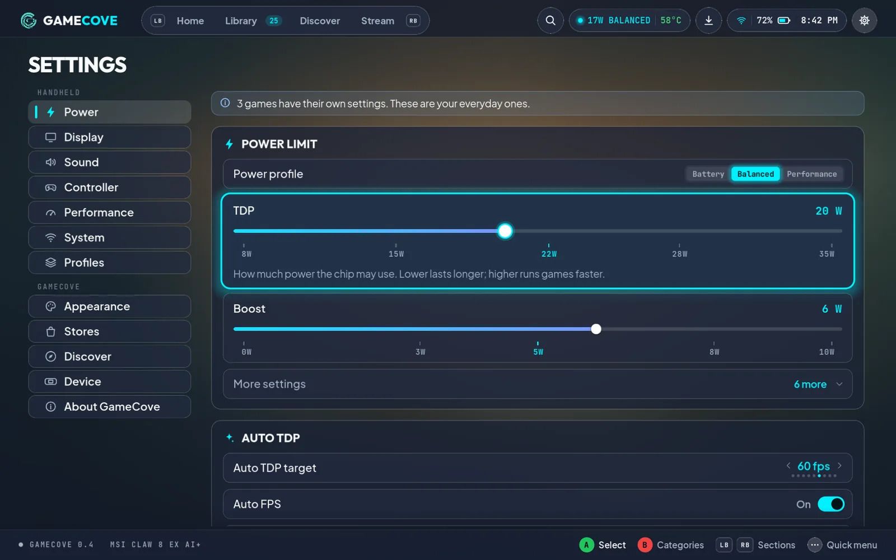<br><sub>Power: battery saver, Sleep at low battery, charge limit</sub></td>
<td width="50%">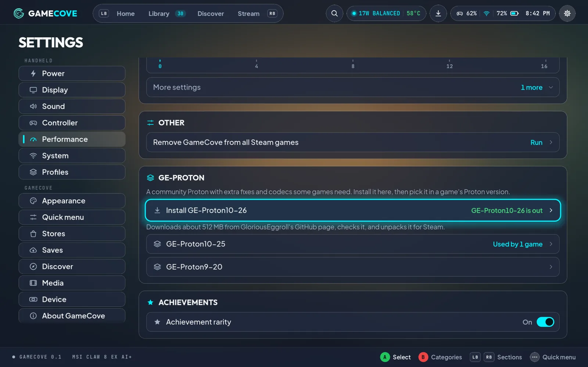<br><sub>Performance: GE-Proton in one press</sub></td>
</tr>
<tr>
<td>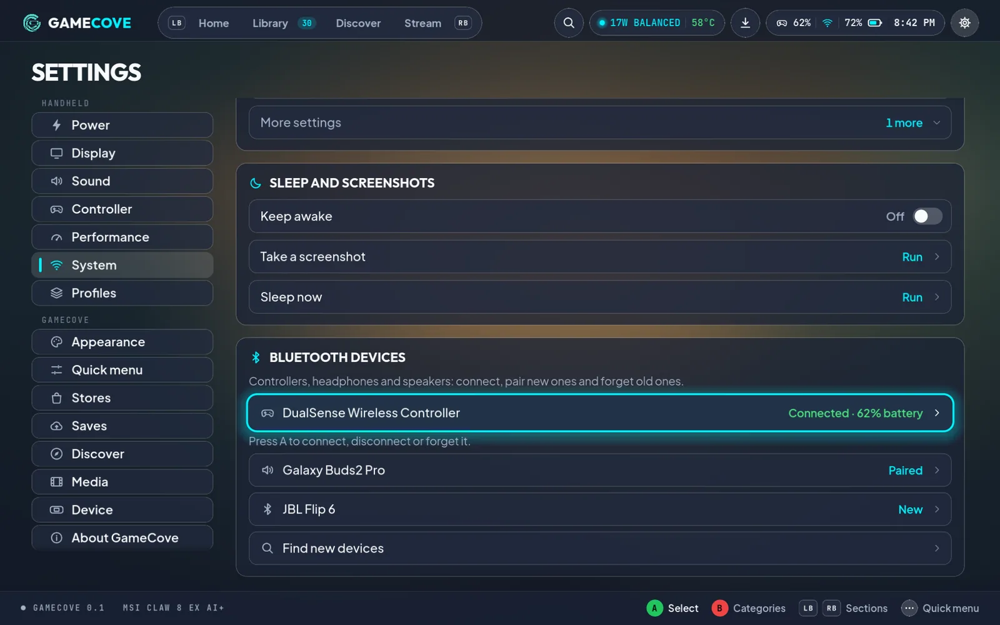<br><sub>System: Bluetooth devices with their battery</sub></td>
<td>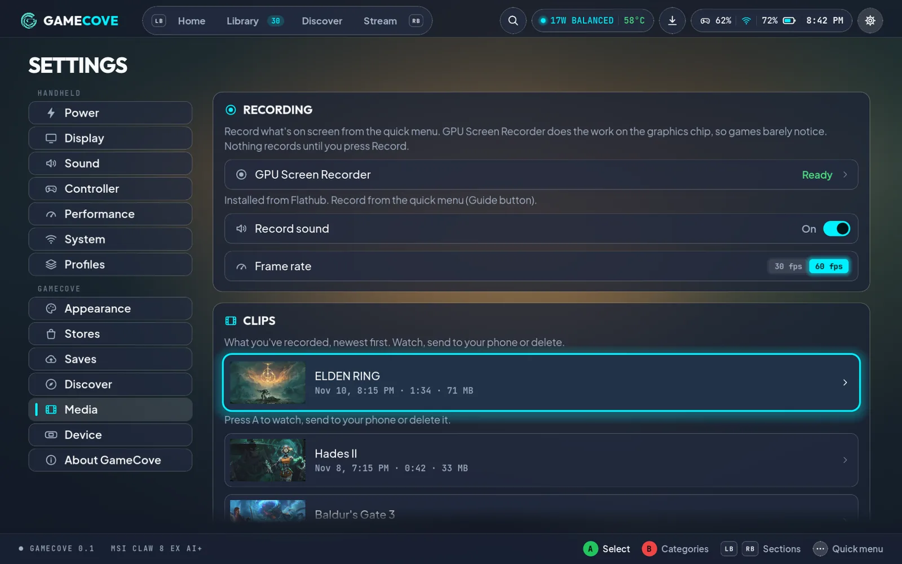<br><sub>Media: recording and your clips</sub></td>
</tr>
<tr>
<td>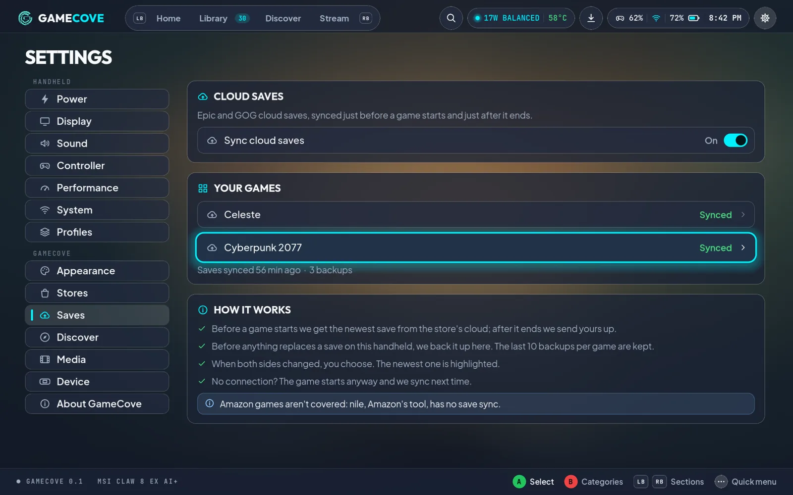<br><sub>Saves: cloud saves for Epic and GOG games</sub></td>
<td>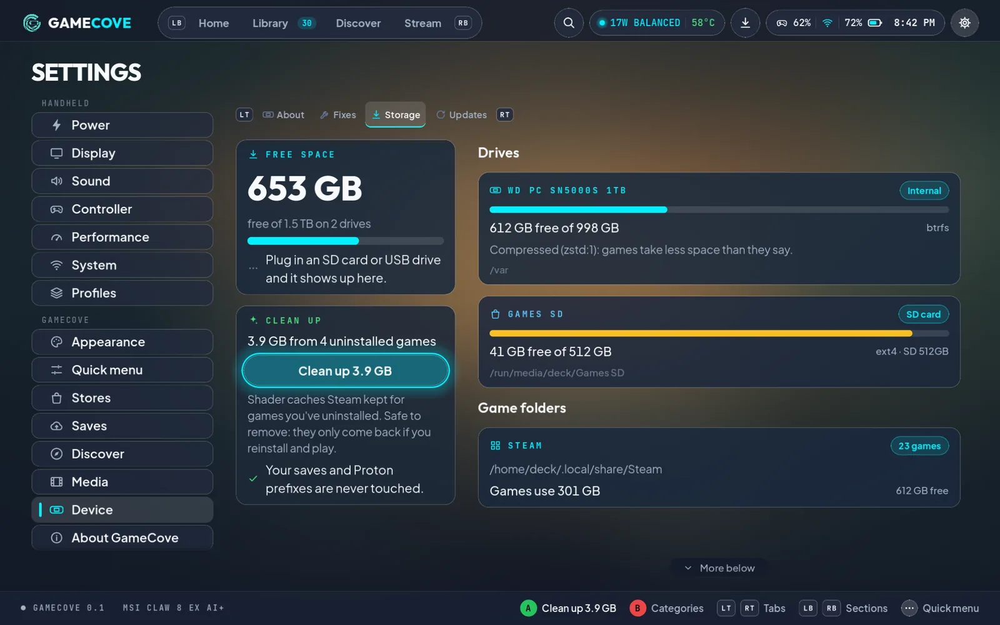<br><sub>Storage: drives, game folders and Clean up</sub></td>
</tr>
</table>

</details>

## Auto TDP, upscaling and frame generation

**Auto TDP** watches your frame rate and finds the lowest power that keeps it, so the battery lasts longer without you
noticing a drop. Give it a target FPS or let it pick one. It learns each game on battery and plugged in, gives power
back within seconds in heavy scenes, skips loading screens, and puts everything back when you quit. It's ported from
ClawDeck, which was built and tuned on real hardware, and works on every handheld with a TDP control.

**Upscaling and frame generation** pick the right thing for your chip, per game:

- **Intel Arc:** XeSS on the XMX cores, FSR 4 on XMX, and XeSS frame generation (2x to 4x), through OptiScaler and the
  XeSS XMX driver.
- **AMD:** FSR 4 on newer chips (using AMD's own files), FSR 3.1 everywhere, FSR frame generation.
- **Any GPU:** Lossless Scaling frame generation through lsfg-vk (2x to 4x, with your own copy of Lossless Scaling).
- **Low latency** (Anti-Lag on AMD, XeLL on Intel Arc) is on by default, and always on while frame generation runs.
- **Always the newest tested files.** GameCove checks once a day, shows what's installed and when an update is out, and
  downloads from its own signed mirror on GitHub (then the project's own release), so a moved download never breaks
  your setup.
- **Clean Undo.** Everything GameCove adds to a game folder is recorded and removed exactly on Undo. Folders set up by
  other tools are left alone.

<!-- Performance section: being written on perf/background. It goes here, after "Auto TDP, upscaling and frame generation" (numbers come from that branch; add a Contents entry with it). -->

## Profiles

Change something in the quick menu while a game runs and it's saved for that game. Set different values for battery
and plugged in, and GameCove switches when you plug in or unplug. When you quit, everything goes back to your everyday
settings.

Order of priority: this game on this power source, then this game, then battery or plugged in, then everyday. Profiles
stay with the handheld they were made on, and you can copy, reset, export and import them.

<p align="center">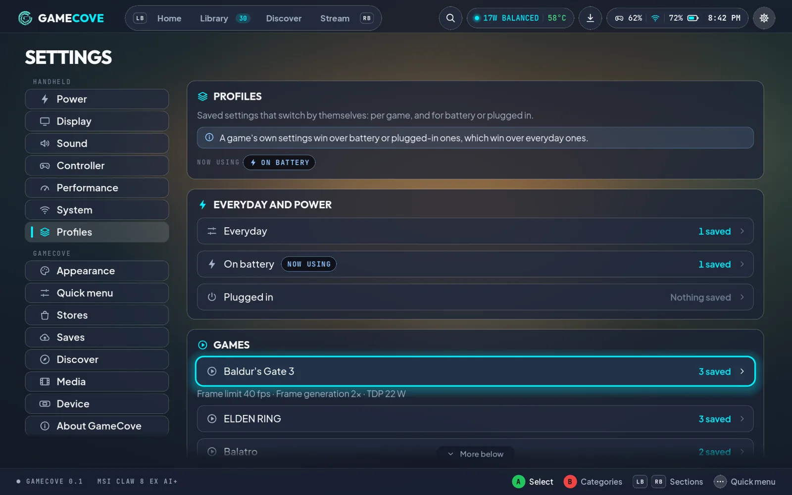</p>

## Device fixes

Settings > Device > **Fixes** lists the fixes for your exact model. The ones your handheld needs are applied when you
install GameCove; optional ones are a press away. Every fix shows its status, says in one line what it does, and has
**Undo**. GameCove also notices when an OS update starts fixing something itself, so you can drop its copy.

<table>
<tr>
<td width="33%">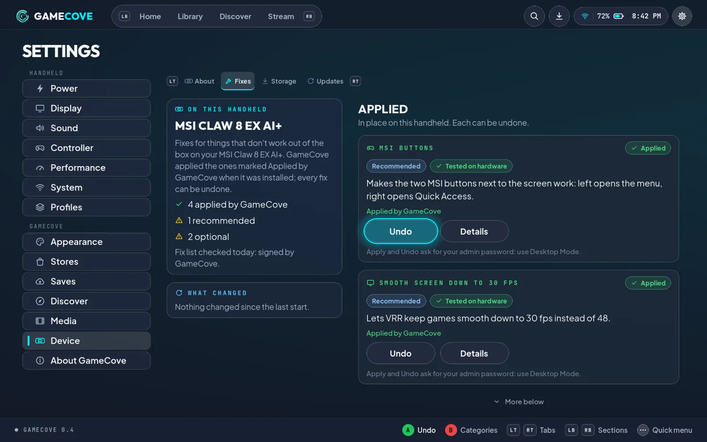<br><sub>Fixes for your exact model, each with Undo</sub></td>
<td width="33%">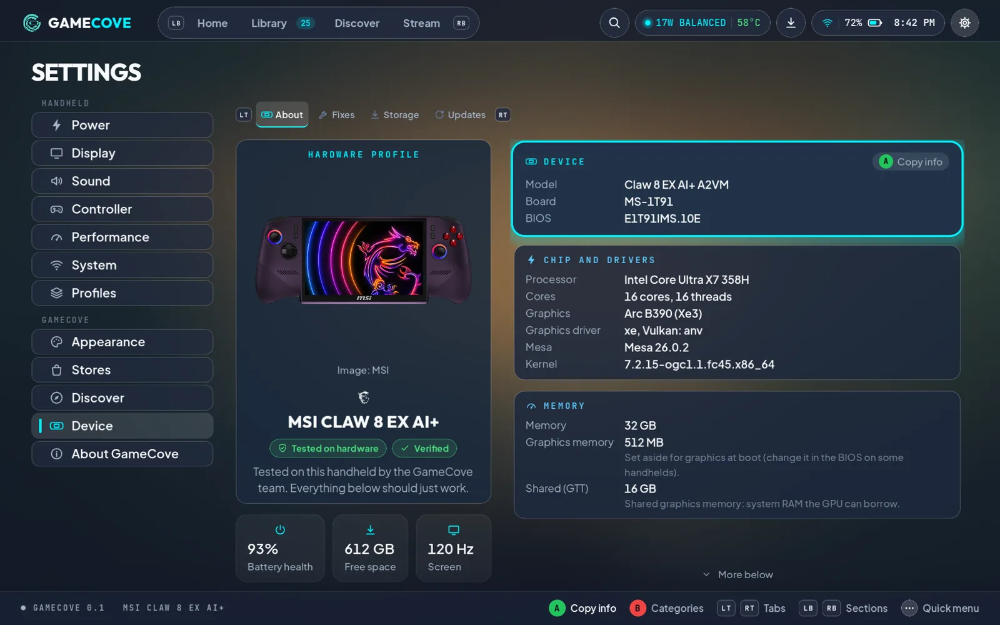<br><sub>About this device: your model, chip, drivers, memory</sub></td>
<td width="33%">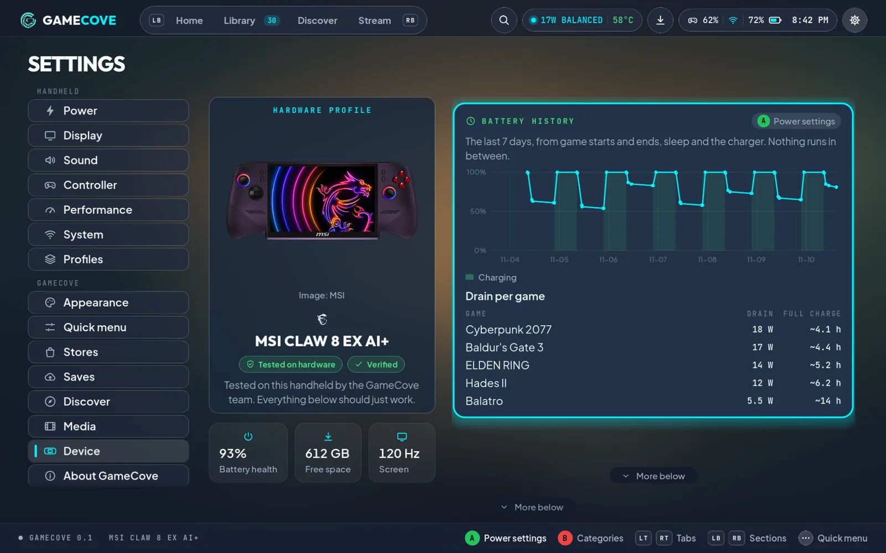<br><sub>Battery history: 7 days and each game's drain</sub></td>
</tr>
</table>

<details>
<summary><b>Every fix, by maker</b></summary>

| Handhelds | Fixes |
| --- | --- |
| **MSI Claw** | MSI buttons next to the screen work (8 EX) · gyro aiming (8 EX) · smooth VRR down to 30 fps instead of 48 (8 EX, 8 AI+; optional on 7 AI+ and A1M) · volume buttons don't wake it in your bag (every Claw) · Wi-Fi comes back after sleep (optional, Intel Claws) |
| **ASUS ROG Ally** | sticks don't wake it (Ally X, Xbox Ally, Xbox Ally X, X20) · no battery drain while off (Ally, Ally X; optional on the Xbox Allys) · less drain while asleep (optional, every Ally) |
| **GPD** | sleep that works (WIN 4, WIN Max 2) · stays asleep (optional, WIN Max 2) · Intel AX210 Wi-Fi after sleep (WIN 5) |
| **AYANEO** | Intel AX210 Wi-Fi after sleep (2, 2S) |
| **OneXPlayer and AOKZOE** | touch lines up with the picture (OneXFly F1; optional on X1, X1 Mini, 2, 2 Pro, A1, A1 Pro) |
| **Every handheld** | keeps GameCove off the game's CPU cores while you play · fan presets and charge limit where the system has no service for them · AX210 Wi-Fi fix offered wherever that card is fitted |

Steam Deck and Legion Go need nothing extra today: the OS already covers them, and GameCove's settings do the rest.
How each fix works: [docs/DEVICE-FIXES.md](docs/DEVICE-FIXES.md).

</details>

## Updates

One page for everything that can be updated:

- **System:** SteamOS, Bazzite and Fedora Atomic updates, with progress, then a restart to finish.
- **BIOS and firmware:** checks your maker's latest BIOS for ASUS, Lenovo, MSI and Steam Deck, with step-by-step
  instructions (for the Ally, GameCove can download the BIOS, check it and put it on a USB drive for EZ Flash). Other
  makers get a link and your current version to compare. Controllers, docks and other parts update through fwupd.
- **Drivers:** kernel, Mesa, firmware, InputPlumber and friends, the XeSS XMX driver and OptiScaler, compared with the
  latest versions.
- **Apps:** Flatpak updates, by hand or **by themselves** once a day when no game is running (turn it on in
  Updates; it runs at the lowest priority, so a game you start meanwhile doesn't feel it).

GameCove never flashes a BIOS by itself, and firmware installs wait until you're on the charger with at least 50%
battery and no game running.

<p align="center">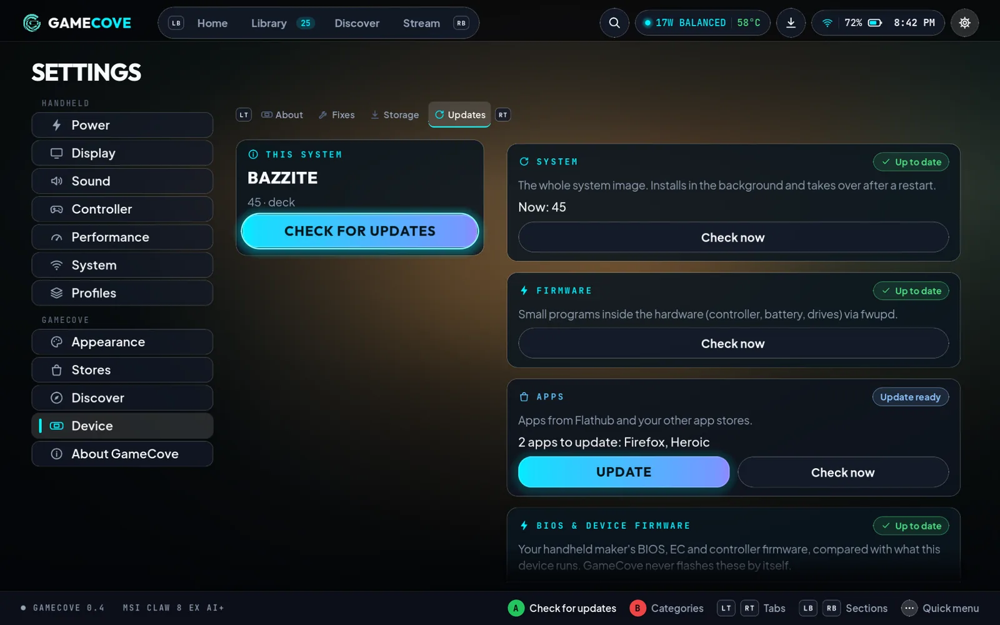</p>

## Streaming from your PC

The **Stream** tab plays games running on your PC. Install [Vibepollo](https://github.com/Nonary/Vibepollo) on the PC
(Sunshine and Apollo work too) and GameCove finds it on your network, pairs with a PIN, shows your PC's games with box
art, wakes the PC, and streams at your handheld's exact resolution and refresh rate through Moonlight (installed for
you). Resolution, frame rate, quality, video format and HDR can be set per PC or per game, and it works away from home
over Tailscale. More in [docs/STREAMING.md](docs/STREAMING.md).

<p align="center">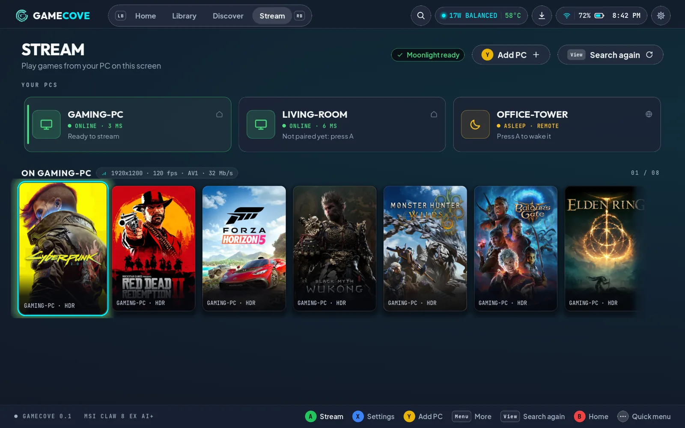</p>

## Discover

- **Deals** from the big stores, sorted and filtered by store, with the Steam review score and the lowest price ever
  next to today's.
- **Real local prices** for your Steam region, never converted guesses. Other stores show "See price" and their own page
  has it in your currency.
- **Your wishlist**, imported from Steam, with price alerts.
- **Free to keep:** games a store is giving away right now (Epic, GOG, Steam and the others CheapShark follows), with
  the store's own page one press away.
- **Release calendar** by month or as a list, with a reminder on release day.

<table>
<tr>
<td width="33%">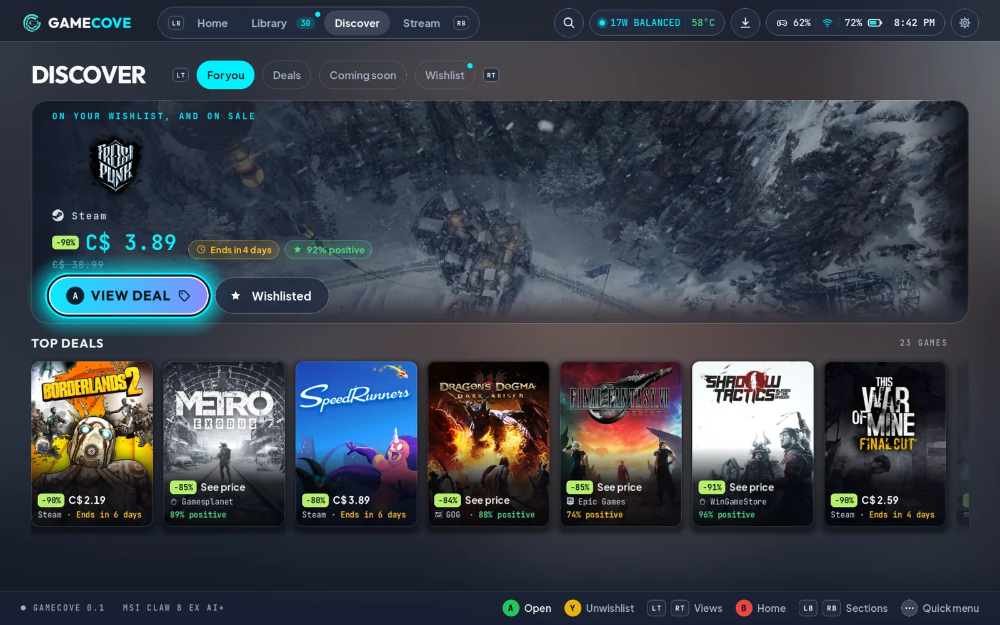<br><sub>Discover: top deals and what's coming</sub></td>
<td width="33%">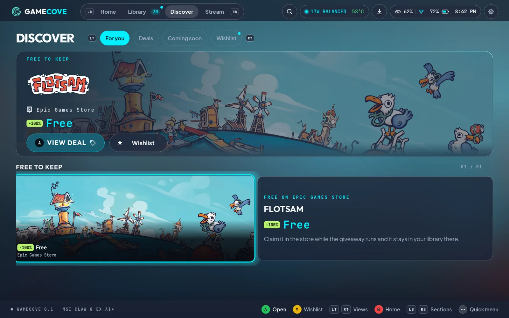<br><sub>Free to keep: what a store gives away now</sub></td>
<td width="33%">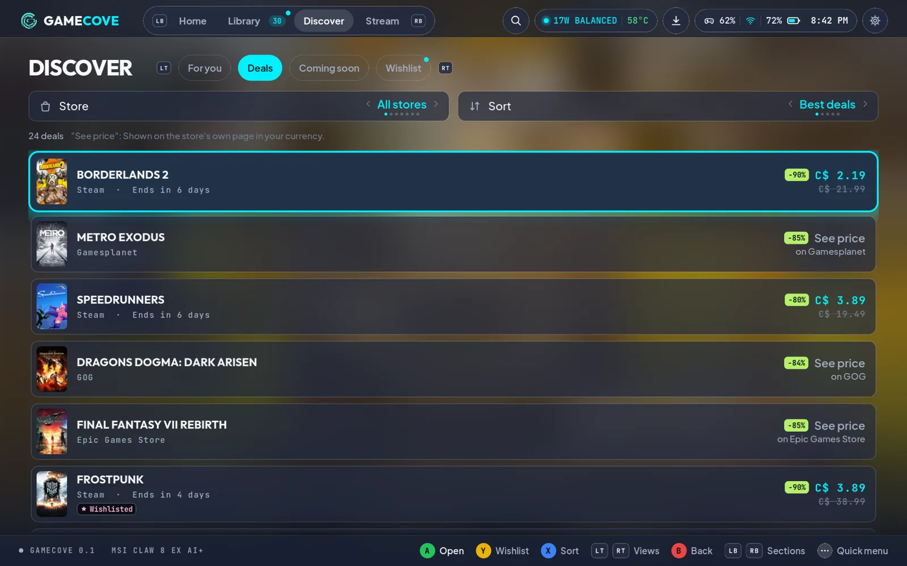<br><sub>Deals with the lowest price ever</sub></td>
</tr>
<tr>
<td>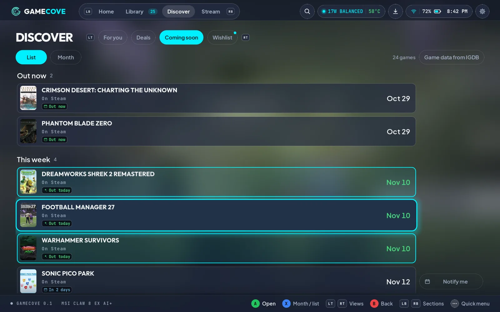<br><sub>Release calendar</sub></td>
<td>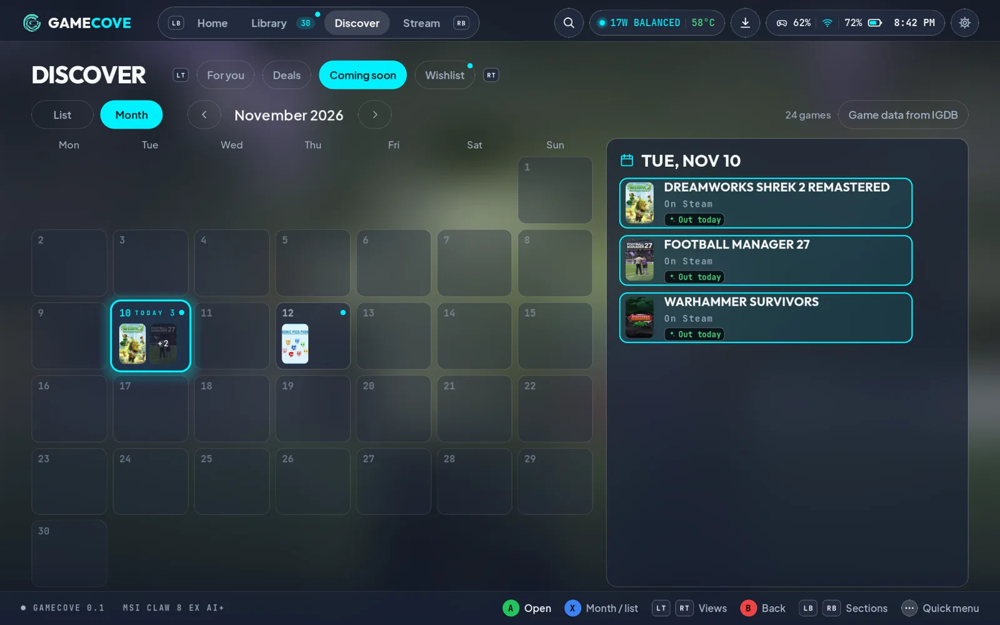<br><sub>The same calendar by month</sub></td>
<td>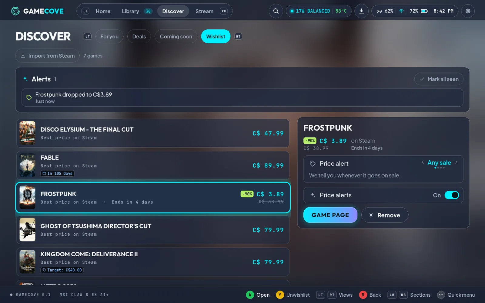<br><sub>Wishlist and price alerts</sub></td>
</tr>
</table>

## Safety and reliability

- **Desktop Mode is always one press away**, from the quick menu, and Steam Gaming Mode too.
- **Crash fallback:** if GameCove crashes, hangs or fails to start three times in a row, your handheld goes back to
  Steam Gaming Mode for the rest of that boot, and GameCove tells you why the next time it opens.
- **Nothing above your device's limits.** Power, boost, clocks, fan curves and charge limits are clamped to what your
  model is rated for, and checked again by the system helper.
- **Risky screen changes revert by themselves.** After HDR or a new refresh rate you get "Keep this?" with a 15-second
  countdown.
- **Saves are never overwritten without a copy.** Before a cloud save replaces one on the handheld (or a backup is
  restored), the current one is backed up locally; a download that fails half way puts it straight back. The last 10
  backups per game are kept, and the game page restores any of them.
- **Undo everything:** fixes, upscaling files, launch options, profiles. Uninstalling puts Steam Gaming Mode back as the
  default.
- **Signed releases.** The installer checks every download against a signed checksum list before anything runs.
- **Day-to-day settings never ask for a password.** Only the install and system fixes do, in Desktop Mode.

## Performance

GameCove stays running behind your games (for the quick menu, power and TDP, and game tracking) and is built to cost
next to nothing there. With a game in front its main loop wakes about 31 times a second instead of 145, nothing polls
for the game's window (one idle `xprop -spy` watches it), the session heartbeat writes nothing, and Discover, the
metadata and art fill and update checks wait until you stop playing. Only safety work keeps running: the 15 s charger
and sleep check that puts your TDP and charge limit back after a resume, the thermal guard, and Auto TDP's once-a-second
sample while it's on. The quick menu still opens over a game in under 100 ms. On our test box that cut GameCove's
wake-ups behind a game from about 2240 to 1190 a second and its CPU time in half; most of what's left is Godot's own X11
event thread. Numbers, what runs and why, and how to measure it on your handheld:
[docs/PERFORMANCE.md](docs/PERFORMANCE.md).

## Network and privacy

No analytics, no crash reports, no telemetry, no GameCove account. GameCove never sends serial numbers, store account
IDs or anything you type into its settings to us. It only talks to the services it needs to do its job.

**Settings > About > Network and privacy** has the switches: **Background lookups** (off: nothing is requested unless
you ask for it right then), **Look up deals and prices**, **Look up game details** and **Show maker photos**, all on by
default; **Sync cloud saves** is in Settings > Saves (and per game). Some store links can carry a GameCove affiliate id (Settings > Discover > **Affiliate links**; none are set up
yet). It only changes the link, never the price, and sends nothing about you. Every call is listed in
[docs/PRIVACY.md](docs/PRIVACY.md).

<details>
<summary><b>Every service GameCove talks to, what it sends and when</b></summary>

| What | Who | What is sent | When | Switch |
| --- | --- | --- | --- | --- |
| Game database and release calendar | GitHub (GameCove's own `gamedb` release) | Nothing about you | At start, at most daily | Background lookups |
| Deals, prices and free-to-keep games (Discover, wishlist) | [CheapShark](https://www.cheapshark.com) (cheapshark.com) and the Steam store API | Steam app ids and titles from your wishlist and Discover, what you search for, your store country | 45 s after start, then every 6 hours (top deals and the free-to-keep list: two requests); when you search or open a game | Look up deals and prices |
| Local prices (optional) | [GG.deals](https://gg.deals) (gg.deals) | Steam app ids, your region, your own API key | With the deals refresh, only if you added a key | Look up deals and prices, or remove the key |
| Your device's photo | GitHub (free photos) or your handheld's maker (ASUS, MSI, Lenovo, ...) | One request; the address tells the site your model | At start until it's saved, then weekly | Show maker photos, Background lookups |
| Upscaler list and downloads (OptiScaler, XeSS driver, FSR 4) | GitHub (GameCove's `upscalers` release, signed list and mirrored files), then the project's own release | Nothing about you | The list at most daily (90 s after start) and before an install; files only when you install or update | Background lookups (daily check); installs: you start them |
| GE-Proton (Settings > Performance) | GitHub (GloriousEggroll's `proton-ge-custom` releases) | Nothing about you | When you press Check or Install | You start it |
| BIOS and firmware list and downloads | GitHub (`firmware` release, signed), then only the maker's own site | Nothing about you | When you check for updates or prepare a USB drive | You start it |
| Steam insights on a game's page (players now, reviews, Steam Deck rating, last update, DLC) | Steam's public API and store | The game's app id (DLC prices: also your store country) | When you open a Steam game's page; players at most every 10 min, the rest every 12 h | Background lookups (prices: Look up deals and prices) |
| Achievements | Steam's API and CDN | The game's app id | When you open a game page | Settings > Performance |
| Game pictures in Discover and the calendar | Steam's CDN, IGDB's image server (`images.igdb.com`) and SteamGridDB's CDN, no other host | The picture's address (it names the game) | When a tile shows a picture that isn't saved yet | None (SteamGridDB lookups: Look up game details) |
| Game details | The Steam store (`appdetails`) | The Steam app id of a game (or of a GOG / Epic / Amazon game's Steam edition) whose details or Metacritic score are missing | In the background after start, one request every 2 s, cached a week; at once for the page you open | Look up game details (+ Background lookups for the background fill) |
| Critic scores (optional) | [OpenCritic](https://opencritic.com) through RapidAPI | A game's title, then its OpenCritic id, with your own key | Same as game details, only if you added a key; at most 20 searches and 180 requests a day | Look up game details, or remove the key |
| Artwork | [SteamGridDB](https://www.steamgriddb.com) | A game's Steam app id or title, with your own key | When you open Change artwork; in the background for games with no cover, hero or logo | Look up game details (+ Background lookups for the automatic fill) |
| Game art setup | Your phone, on your own network, then SteamGridDB | Your SteamGridDB key: pasted on a one-time page GameCove serves on your LAN, then checked once with SteamGridDB | Only while the Game art step is open, 10 minutes at most | You start it |
| Emulation tools | Whatever EmuDeck, RetroDECK, ES-DE and Steam ROM Manager contact themselves | Those tools' own requests (GameCove only reads their files, on the device) | Only while you have them open from the Emulation page | You start it |
| Sending a clip to your phone | Your phone, on your own network | The clip itself, from a one-time page GameCove serves on your LAN; nothing leaves your network | Only while the Send to phone code shows, until it's downloaded or 10 minutes pass | You start it |
| GPU Screen Recorder and a video player (Settings > Media) | Flathub, through Flatpak | Flatpak's own requests | When you press Install (the recorder, or mpv to watch clips) | You start it |
| Game streaming | PCs on your own network (GameStream: Vibepollo, Sunshine, Apollo) | A fixed client id and Moonlight's certificate; Wake-on-LAN packets. With no PC saved and none found by mDNS, a connection attempt to port 47989 on every address of your local network | When you open the Stream tab or wake a PC | You start it |
| Cloud saves (Epic, GOG) | Epic and GOG, through legendary and heroic-gogdl (GOG's remote config once for a game Heroic doesn't know) | Your save files for the game you start or just closed, with your store sign-in; for GOG's remote config only the game's client id | Just before an Epic or GOG game starts and just after it ends; when you press Sync now | Sync cloud saves (Settings > Saves; also per game) |
| Updates, store sign-ins | Your OS, Flatpak, fwupd/LVFS, legendary / gogdl / nile | Those tools' own requests | When you update or sign in; Flatpak apps also once a day if you turned on "Update apps by themselves" | You start it (automatic app updates: off by default, and Background lookups) |

</details>

<p align="center">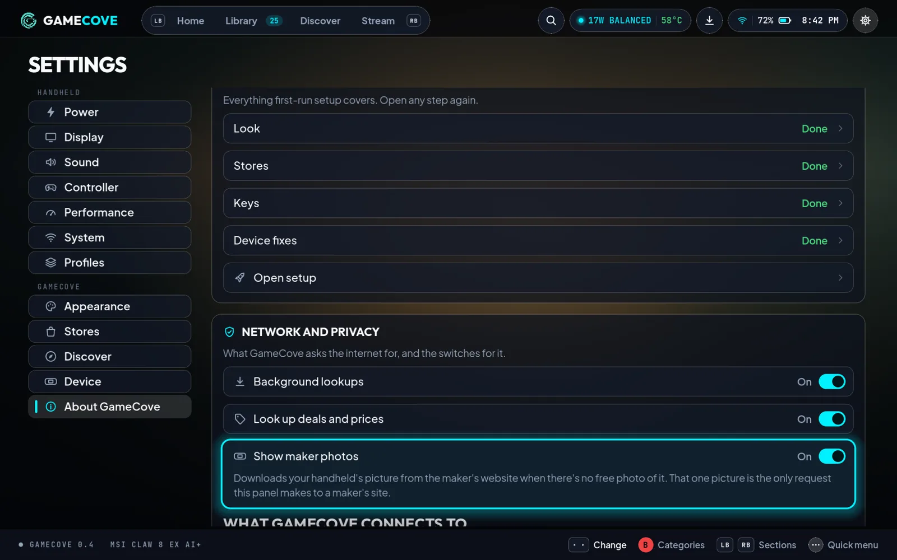</p>

## Supported handhelds

GameCove recognises your exact model and sets itself up for it. About this device in the app shows a photo of yours.

| Maker | Tested on hardware | Supported | Basic |
| --- | --- | --- | --- |
| **MSI** | Claw 8 EX AI+ (Bazzite) | Claw 8 AI+, Claw 7 AI+, Claw A1M, Claw A8 | |
| **ASUS** | ROG Ally (SteamOS) | ROG Ally X, ROG Xbox Ally, ROG Xbox Ally X, ROG Xbox Ally X20 | |
| **Valve** | | Steam Deck LCD, Steam Deck OLED | |
| **Lenovo** | | Legion Go, Legion Go 2 (and Z2), Legion Go S (Z2 Go and Z1 Extreme) | |
| **OneXPlayer** | | OneXFly F1, F1 Pro and Apex; X1 (AMD, Intel, Mini, Pro); 2 and 2 Pro; G1 (AMD, Intel); 3 | X2 Mini, X2 Mini Pro, Super X |
| **AOKZOE** | | A1, A1 Pro, A1X | |
| **AYANEO** | | 2, 2S, 3, KUN, AIR 1S, AIR Plus, Flip, Flip 1S DS, Slide | |
| **GPD** | | WIN 4, WIN Mini, WIN Max 2, WIN 5 | |
| **ZOTAC** | | Gaming Zone | |
| **Acer** | | Predator Atlas 8 | Nitro Blaze 7, 8 and 11 |
| **Orange Pi** | | Neo | |

- **Tested on hardware:** we've run GameCove on it. Every setting was changed, read back from the hardware and put back.
- **Supported:** set up from data that InputPlumber, steamos-manager, PowerStation and Handheld Daemon tested on that
  device. Power limits, fans, lights, buttons and fixes are all there.
- **Basic:** GameCove runs with safe settings for the chip, and model-specific settings stay hidden until someone with
  the device helps us test it. Any other handheld gets this too.

Got one of the Supported or Basic models? Run it and [tell us how it went](https://github.com/IHulkSmashI/GameCove/issues/new?template=tester_signup.yml);
that's how a model moves up. Details per device: [docs/DEVICES.md](docs/DEVICES.md).

<details>
<summary><b>See every model</b></summary>
<br>

<p align="center">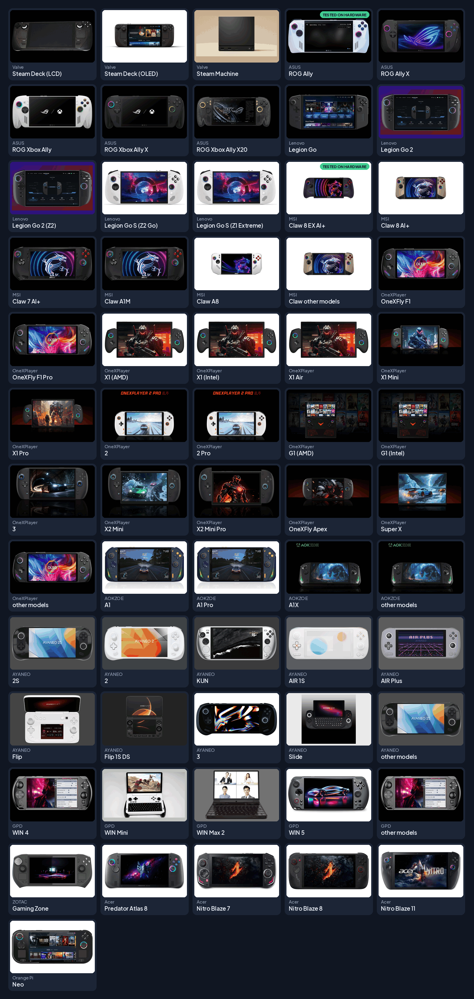</p>

<sub>Photos: the makers' official product images (their property, removed on request), except Steam Deck (LCD) by Liam Dawe/GamingOnLinux, <a href="https://commons.wikimedia.org/wiki/File:Steam_Deck_(front).png">CC BY-SA 4.0</a>.</sub>

</details>

## Install

1. Switch to Desktop Mode and open a terminal (Konsole).
2. Run:
   ```sh
   curl -fsSL https://raw.githubusercontent.com/IHulkSmashI/GameCove/main/packaging/get-gamecove.sh | bash
   ```
   It downloads the latest release, checks its signature, adds **GameCove Installer** to your app menu and opens it.
3. The installer walks you through it: **Easy** (recommended settings, one summary page) or **Custom** (every option).
   Choose whether your handheld boots into GameCove or keeps Steam Gaming Mode as the default with GameCove one tap
   away, sign in to your stores, get free game art, pick your fixes and extras (like Moonlight for streaming), and
   you're done.

It asks for your admin password once, for the system package and device fixes.

- **Bazzite and Fedora Atomic:** installs as a system package. Your previous system stays in the boot menu.
- **SteamOS:** installs as a system extension that survives SteamOS updates. Read-only mode stays on. After a SteamOS
  update, restart once so GameCove comes back.
- **Anything else:** you can try GameCove in a window.

### Game art

The installer's Game art step (or GameCove's own first-run setup) gets you a free
[SteamGridDB](https://www.steamgriddb.com) key in about a minute. Scan the QR code with your phone, sign in with Steam,
tap Generate API key, then paste the key on the page your phone opened and it lands on the handheld by itself (no
typing with a controller; typing or pasting it works too). GameCove checks the key, then fills in covers, banners and
logos for every game, Steam or not. GameCove ships no key of its own, so this step is what turns on the art picker and
art for non-Steam games. Skip it and you get Steam's art; add a key later in Settings > Discover > SteamGridDB key.

<table>
<tr>
<td width="50%">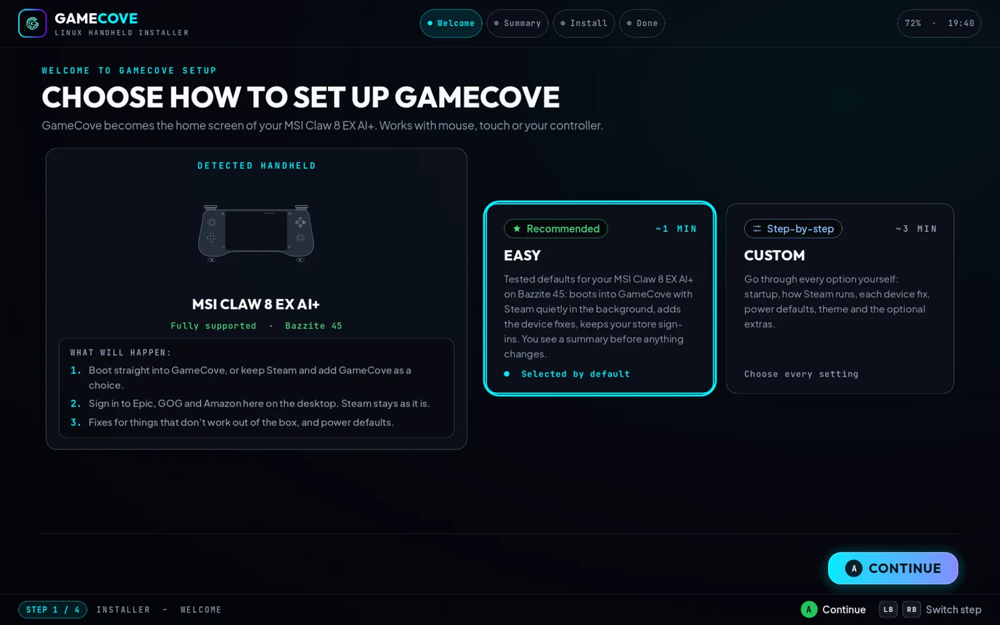<br><sub>The installer: Easy or Custom</sub></td>
<td width="50%">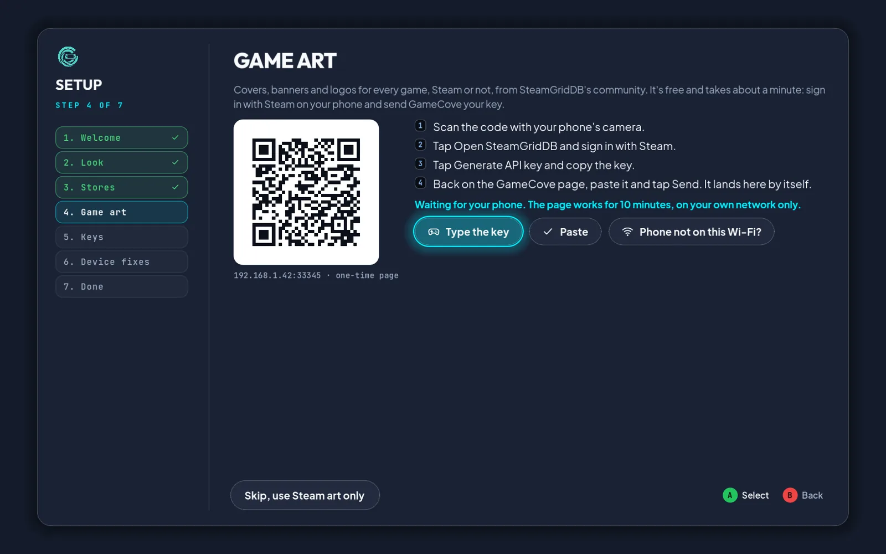<br><sub>Game art: scan, sign in with Steam on your phone, done</sub></td>
</tr>
<tr>
<td>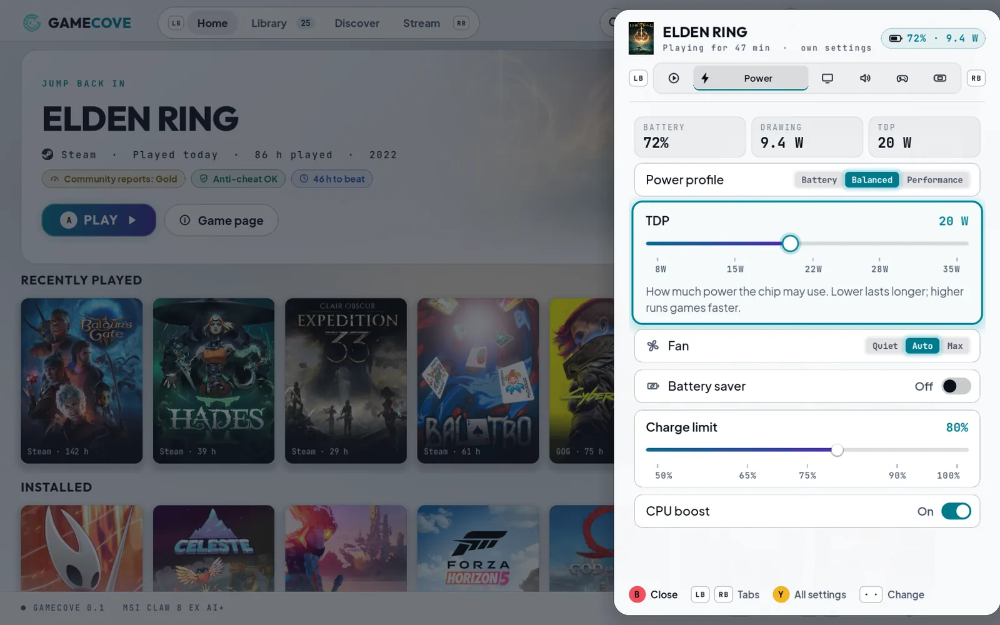<br><sub>Pick your look during setup: here, Light</sub></td>
<td>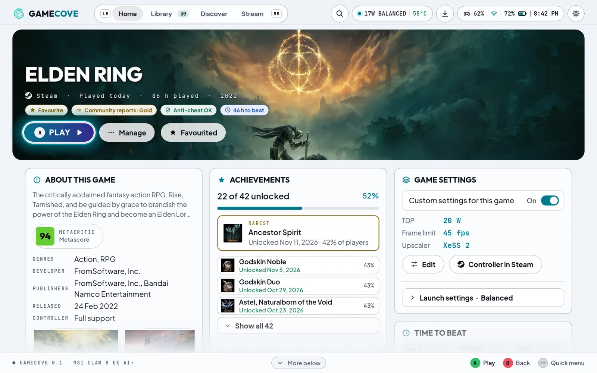<br><sub>A game page in Light, art at full colour</sub></td>
</tr>
</table>

### Update, change or remove

Open **GameCove Installer** from the app menu any time to **update**, **change options**, **repair** or **remove**
GameCove. Removing it makes Steam Gaming Mode the default again, can undo every fix, and can keep or delete your
settings. Store sign-ins stay with the store tools. Everything the installer does is logged to
`~/.local/share/gamecove/installer.log`. Manual install: [docs/SESSION.md](docs/SESSION.md).

## FAQ

<details>
<summary><b>Does it replace Steam?</b></summary>

No. Steam keeps running in the background, Steam games launch through Steam, and Steam Gaming Mode is always one press
away.
</details>

<details>
<summary><b>Do you need Decky Loader or any plugins?</b></summary>

No. Power, Auto TDP, fans, lights, the overlay, upscaling and frame generation are all built in. If you already use
Decky plugins, GameCove leaves their files alone.
</details>

<details>
<summary><b>Can it break your system?</b></summary>

Everything GameCove changes can be undone, on Bazzite your previous system stays in the boot menu, and if GameCove
keeps crashing or won't start you land in Steam Gaming Mode.
</details>

<details>
<summary><b>Does anti-cheat work?</b></summary>

Games run on the same Proton as they do in Steam. GameCove shows each game's anti-cheat status, and it never bypasses
or tampers with anti-cheat.
</details>

<details>
<summary><b>Does it cost anything?</b></summary>

No. GameCove is free and open source, and device fixes, battery features and safety settings will never sit behind a
paywall. Game art and critic scores use free keys that are yours, not ours.
</details>

<details>
<summary><b>What about CachyOS or other distros?</b></summary>

Bazzite and SteamOS come first. On other systems GameCove runs in a window, and a CachyOS package is planned.
</details>

<details>
<summary><b>How does recording work, and does it slow games down?</b></summary>

Press **Record** in the quick menu (This game) and GameCove starts [GPU Screen Recorder](https://git.dec05eba.com/gpu-screen-recorder/about/),
which captures the screen and encodes H.264 on your handheld's video engine (VA-API on AMD and Intel), so a game loses
a frame here and there at most. It only runs while you record; there's no always-on replay buffer. Clips go to
**Videos/GameCove/&lt;game&gt;**. The first time, Settings > Media installs it from Flathub, and screen capture needs a
one-time OK with your admin password, which only Desktop Mode can ask for: switch there once, open GameCove and press
**Allow screen capture**.
</details>

<details>
<summary><b>Your handheld isn't listed?</b></summary>

It still runs with Basic support. [Sign up to test](https://github.com/IHulkSmashI/GameCove/issues/new?template=tester_signup.yml)
with your device report and we'll add it.
</details>

## Community

- **Discord:** chat, testing and help, [discord.gg/tuUsn6sSZH](https://discord.gg/tuUsn6sSZH)
- **Reddit:** news and tips, [r/GameCoveLinux](https://www.reddit.com/r/GameCoveLinux/)
- **GitHub:** [bugs and ideas](https://github.com/IHulkSmashI/GameCove/issues/new/choose),
  [discussions](https://github.com/IHulkSmashI/GameCove/discussions), and
  [sign up to test on your handheld](https://github.com/IHulkSmashI/GameCove/issues/new?template=tester_signup.yml)

More in [docs/COMMUNITY.md](docs/COMMUNITY.md). GameCove is free; if you'd like to chip in:
[ko-fi.com/gamervault](https://ko-fi.com/gamervault).

## Credits

GameCove has its own front end and device layer, built on proven open-source work: gamescope, Proton and umu-launcher,
InputPlumber, PowerStation, steamos-manager and Handheld Daemon, legendary, gogdl and nile for the stores, MangoHud,
OptiScaler, lsfg-vk and Moonlight. Auto TDP, the upscaling setup and the MSI Claw findings are ported from
**ClawDeck** (same author). Gyro on the MSI Claw 8 EX was figured out by **Kisenir** (r/MSIClaw).

Our game database is rebuilt nightly from free, open sources (Wikidata, AreWeAntiCheatYet, ProtonDB, IGDB, the Steam
store) and published as a download; see [`gamedb/`](gamedb/). Game data from [IGDB](https://www.igdb.com): time to beat, game details, critic averages and upcoming release dates. [Metacritic](https://www.metacritic.com) scores as Valve publishes them on the Steam store, each linked to its Metacritic page. Critic scores from [OpenCritic](https://opencritic.com), fetched by the app only with your own key. Artwork from [SteamGridDB](https://www.steamgriddb.com) and its artists, fetched with your own free key. Compatibility tiers are our own summary of [ProtonDB](https://www.protondb.com) community reports, shared under the ODbL 1.0. The full list is in [CREDITS.md](CREDITS.md).

Contributing: [CONTRIBUTING.md](CONTRIBUTING.md).

## Licence

GPL-3.0-or-later. See [LICENSE](LICENSE). Copyright © 2026 Mena Hanna.

"GameCove" and the GameCove logo are trademarks of Mena Hanna. Forks are welcome under the GPL but need their own name
and logo; see [TRADEMARKS.md](TRADEMARKS.md). Contributors sign a short [CLA](docs/CLA.md) once (you keep your
copyright); details in [CONTRIBUTING.md](CONTRIBUTING.md).

A few parts carry their own licences: the Claw 8 EX gyro fix's HID-BPF program is GPL-2.0-only and its helper scripts
GPL-2.0-or-later; the VRR fix's panel list derives from MIT-licensed code; the app is built on Godot Engine (MIT); the
fonts are OFL-1.1. Every release carries these texts, and the app shows them under Settings > About > Credits and
licenses. Details in [CREDITS.md](CREDITS.md) and [LICENSES/](LICENSES/).

**The brand logos in `app/assets/brand/` are not GPL-licensed.** They're the makers' and stores' trademarks, shown only
to identify a device, chip, store or launcher, and removed on request ([docs/BRANDS.md](docs/BRANDS.md),
[app/assets/brand/LICENSE.md](app/assets/brand/LICENSE.md)). Device photos are the makers' property: most are fetched
from the maker's own site when the app needs them, one (the Acer Nitro Blaze 8) is bundled, and the README's device
grid shows them all. Any of them is removed on request. GameCove isn't affiliated with or endorsed by any of these
companies.
