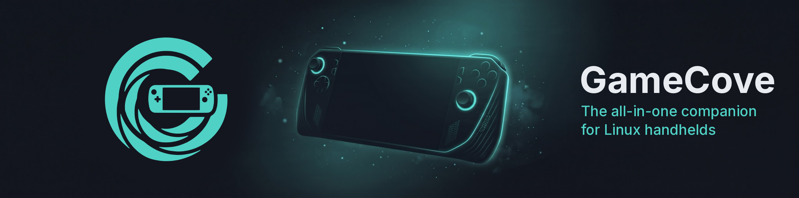

<p align="center"></p>

# GameCove

**The all-in-one companion for Linux handhelds.**

GameCove is a free, open-source, controller-first home screen for gaming handhelds. You boot into it, every store's games sit in one library, and your device's power, fan, screen and controller settings are built in. No plugins, no extra apps.

> Early development. Untested on hardware: try it if you're comfortable rolling back.

## Install

In Desktop Mode, open a terminal and run:

```sh
curl -fsSL https://raw.githubusercontent.com/IHulkSmashI/GameCove/main/packaging/get-gamecove.sh | bash
```

It downloads the latest release (checked against its SHA256SUMS), adds **GameCove Installer** to your app menu and opens it. The installer walks you through it, like EmuDeck: Easy (recommended defaults, one summary page) or Custom (every option). It can make GameCove what your handheld boots into, or keep Steam Gaming Mode as the default with GameCove as a choice, signs in your stores in the browser, installs device fixes and sets everything up so the first start needs nothing. It asks for your admin password only for the system package and device fixes.

- **Bazzite / Fedora Atomic:** installs as a layered package (`rpm-ostree`); a restart finishes it, and your previous system stays in the boot menu.
- **SteamOS:** installs as a system extension (sysext) kept on the home partition and linked from `/etc/extensions`, so SteamOS updates keep it; `steamos-readonly` stays on.
- **Anything else:** you can try GameCove in a window.

Run **GameCove Installer** again any time to change options, repair, update or remove GameCove (removing makes Steam Gaming Mode the default again). Everything it does is logged to `~/.local/share/gamecove/installer.log`. If GameCove crashes, hangs or fails to start three times in a row, your handheld goes back to Steam Gaming Mode for the rest of that boot, and GameCove tells you why the next time it opens. Manual install: [docs/SESSION.md](docs/SESSION.md).

## What it does

- **One library:** Steam, Epic, GOG and Amazon in one place, with installs, updates and a download queue. EA, Ubisoft, Battle.net, emulators and cloud come later.
- **Game info on every tile:** cover art, time to beat, compatibility and anti-cheat status before you hit play.
- **Complete game details for every store:** missing descriptions, genres, developers, publishers, release dates, screenshots and art are filled in for Steam, Epic, GOG and Amazon games alike, with Metacritic and OpenCritic scores on the game page, Top rated sorting and genre filters, and a SteamGridDB artwork picker (it can update Steam's own library art too).
- **A quick menu that makes sense:** one button, five sections (This game, Power, Screen, Controller, Device), and a short line under every setting saying what it does. Performance overlay, Auto TDP status and Exit game are right there.
- **Your handheld, set up properly:** power profiles, auto TDP, fan, charge limit, VRR, device fixes, and the right upscaling and frame generation for your chip, picked per game.
- **Discover:** deals, real local prices, your wishlist with price alerts, and a release calendar.
- **Two-minute setup:** pick a look, sign in to stores with your phone (scan a QR code, no typing passwords on the handheld), add optional free keys, see what your device needs.
- **Settings in one place:** appearance and four themes, stores and downloads, Discover, performance, device and updates.
- **Steam stays a store:** Steam games launch through Steam, so your Steam library keeps working. "Switch to Steam Gaming Mode" is always one press away.

## Devices

**Full** = tested on the device by us. **Partial** = built from upstream data that was tested on the device, but we haven't run GameCove on it yet. Anything else (or an unknown model) gets the generic path, with device-specific settings hidden.

| Maker | Models | Support |
| --- | --- | --- |
| MSI | Claw 8 EX AI+ | Full (our test device) |
| MSI | Claw 8 AI+, Claw 7 AI+, Claw A1M, Claw A8 | Partial |
| Valve | Steam Deck (LCD, OLED) | Partial |
| ASUS | ROG Ally, Ally X, Xbox Ally, Xbox Ally X, Xbox Ally X20 | Partial |
| Lenovo | Legion Go, Legion Go 2 (and Z2), Legion Go S (Z2 Go, Z1 Extreme) | Partial |
| OneXPlayer | OneXFly F1, F1 Pro, Apex; X1 (AMD, Intel, Mini, Pro); 2, 2 Pro; G1 (AMD, Intel); 3 | Partial |
| AYANEO | 2, 2S, 3, KUN, AIR 1S, AIR Plus, Flip, Flip 1S DS, Slide | Partial |
| AOKZOE | A1, A1 Pro, A1X | Partial |
| GPD | WIN 4, WIN Mini, WIN Max 2, WIN 5 | Partial |
| ZOTAC, Acer, Orange Pi | Gaming Zone, Predator Atlas 8, Neo | Partial |
| Others | OneXPlayer X2 Mini and Super X, Acer Nitro Blaze 7 / 8 / 11, unknown models | Generic |

Details per device: [docs/DEVICES.md](docs/DEVICES.md); the data lives in [`app/data/devices.json`](app/data/devices.json). Own a handheld that isn't listed? Open an issue with your device report.

## Built on

GameCove writes its own front end and device layer and reuses proven open-source parts underneath: gamescope, Proton through umu-launcher, InputPlumber, PowerStation and steamos-manager, and legendary, gogdl and nile for the stores. See [CREDITS.md](CREDITS.md).

## Game data

Our game database is rebuilt nightly from free, open sources (Wikidata, AreWeAntiCheatYet, ProtonDB, IGDB, the Steam store) and published as a download. See [`gamedb/`](gamedb/).

Game data from [IGDB](https://www.igdb.com): time to beat, game details, critic averages and upcoming release dates. [Metacritic](https://www.metacritic.com) scores as Valve publishes them on the Steam store, each linked to its Metacritic page. Critic scores from [OpenCritic](https://opencritic.com), fetched by the app only with your own key. Artwork from [SteamGridDB](https://www.steamgriddb.com) and its artists. Compatibility tiers are our own summary of [ProtonDB](https://www.protondb.com) community reports, shared under the ODbL 1.0.

## Network and privacy

GameCove has no analytics, no crash reporting and no account of its own, and never sends serial numbers, Steam account ids or anything you type into its settings to us. It does talk to a few services to do its job. Everything it contacts:

| What | Who | What is sent | When | Switch |
| --- | --- | --- | --- | --- |
| Game database and release calendar | GitHub (GameCove's own `gamedb` release) | Nothing about you | At start, at most daily | Background lookups |
| Deals and prices (Discover, wishlist) | [CheapShark](https://www.cheapshark.com) and the Steam store API | The Steam app ids and titles on your wishlist and in Discover, what you search for, your store country | 45 s after start, then every 6 hours; when you search or open a game | Look up deals and prices |
| Local prices (optional) | [GG.deals](https://gg.deals) | Steam app ids, your region, your own API key | With the deals refresh, only if you added a key | Look up deals and prices, or remove the key |
| Your device's photo | GitHub (free photos) or your handheld's maker (ASUS, MSI, Lenovo, ...) | One request; the address tells the site your device model | At start until it's saved, then weekly | Show maker photos, Background lookups |
| Upscaler list and downloads (OptiScaler, XeSS driver, FSR 4) | GitHub (GameCove's `upscalers` release, signed list and mirrored files), then the project's own release | Nothing about you | The list at most daily (90 s after start) and before an install; files only when you install or update | Background lookups (daily check); installs: you start them |
| Firmware list and downloads | GitHub (`firmware` release, signed), then only the maker's own site | Nothing about you | When you check for updates or prepare a USB drive | You start it |
| Steam insights on a game's page (players now, reviews, Steam Deck rating, last update, DLC) | Steam's public API and store | The game's app id (DLC prices: also your store country) | When you open a Steam game's page; players at most every 10 min, the rest every 12 h | Background lookups (prices: Look up deals and prices) |
| Achievements and game art | Steam's API and CDN | The game's app id | When you open a game page or a tile needs art | Settings > Performance |
| Game details | The Steam store (`appdetails`) | The Steam app id of a game (or of a GOG / Epic / Amazon game's Steam edition) whose details or Metacritic score are missing | In the background after start, one request every 2 s, cached a week; at once for the page you open | Look up game details (+ Background lookups for the background fill) |
| Critic scores (optional) | [OpenCritic](https://opencritic.com) through RapidAPI | A game's title, then its OpenCritic id, with your own key | Same as game details, only if you added a key; at most 20 searches and 180 requests a day | Look up game details, or remove the key |
| Artwork | [SteamGridDB](https://www.steamgriddb.com) | A game's Steam app id or title, with your key or GameCove's | When you open Change artwork; in the background for games with no cover, hero or logo | Look up game details (+ Background lookups for the automatic fill) |
| Game streaming | PCs on your own network (GameStream: Sunshine, Apollo, Vibepollo) | A fixed client id and Moonlight's certificate; Wake-on-LAN packets | When you open the Stream tab or wake a PC | You start it |
| Updates, store sign-ins | Your OS, Flatpak, fwupd/LVFS, legendary / gogdl / nile | Those tools' own requests | When you update or sign in | You start it |

Settings > About > **Network and privacy** has the switches: **Background lookups** (off: nothing is requested unless you ask for it right then), **Look up deals and prices**, **Look up game details** and **Show maker photos**, all on by default. Store links can carry a GameCove affiliate id (Settings > Discover > Affiliate links, on by default; none are set up yet); it changes only the link, never the price, and sends nothing about you. Details: [docs/PRIVACY.md](docs/PRIVACY.md).

## What we'll never do

- Paywall a device fix, battery feature or safety setting.
- Bypass, spoof or tamper with anti-cheat.
- Modify Steam or take over its interface.

## Community

Bugs and ideas: [GitHub issues](https://github.com/IHulkSmashI/GameCove/issues/new/choose) and [Discussions](https://github.com/IHulkSmashI/GameCove/discussions). Chat and testing: [Discord](https://discord.gg/tuUsn6sSZH). News and tips: [r/GameCoveLinux](https://www.reddit.com/r/GameCoveLinux/). Want to test on your handheld? [Sign up here](https://github.com/IHulkSmashI/GameCove/issues/new?template=tester_signup.yml). More in [COMMUNITY.md](docs/COMMUNITY.md).

## Thanks

Gyro on the MSI Claw 8 EX was figured out by **Kisenir** (r/MSIClaw). Full list in [CREDITS.md](CREDITS.md).

## License

GPL-3.0-or-later. See [LICENSE](LICENSE).

A few parts carry their own licenses: the gyro fix's HID-BPF program is GPL-2.0-only and its helper scripts GPL-2.0-or-later ([LICENSES/GPL-2.0-only.txt](LICENSES/GPL-2.0-only.txt)); the VRR fix's panel list and EDID logic derive from MIT-licensed code ([fixes/claw8ex-vrr/LICENSE.ClawLab-MIT](fixes/claw8ex-vrr/LICENSE.ClawLab-MIT)); the app is built on Godot Engine (MIT, with its third-party notices in [LICENSES/](LICENSES/)); the bundled fonts are OFL-1.1 (`app/fonts/OFL-*.txt`); the QR code encoder is MIT; and the Heroic Games Launcher icon in `app/assets/brand/` is GPL-3.0-only. Every release artefact carries these texts (`packaging/licenses.list`), and the app shows them under Settings > About > Credits and licenses. Details in [CREDITS.md](CREDITS.md).

**The brand logos in `app/assets/brand/` are not GPL-licensed.** They are the makers' and stores' trademarks, shown only to identify a device, chip, store or launcher, and removed on request ([docs/BRANDS.md](docs/BRANDS.md), [app/assets/brand/LICENSE.md](app/assets/brand/LICENSE.md)). Maker product photos are linked on the maker's site, not bundled, with one exception: a front picture of the Acer Nitro Blaze 8 (`app/assets/device_photos/`) is bundled because no linkable head-on image of it exists; it isn't GPL-licensed either.

Product and company names are trademarks of their respective owners; GameCove is not affiliated with or endorsed by them. See [CREDITS.md](CREDITS.md#trademarks).
